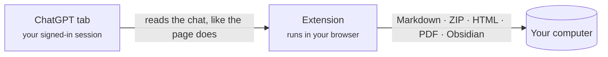

  

<h1 align="center">Chat &amp; Intelligent UI Exporter for ChatGPT</h1>

  Save ChatGPT conversations, including their interactive <b>Intelligent UI</b> cards, 
  as Markdown, HTML, PDF or straight into Obsidian. Everything happens on your computer.

  
  
  
  
  

  <b>English</b> ·
  <a href="docs/readme/README.zh-CN.md">简体中文</a> ·
  <a href="docs/readme/README.zh-TW.md">繁體中文</a> ·
  <a href="docs/readme/README.ja.md">日本語</a> ·
  <a href="docs/readme/README.ko.md">한국어</a> ·
  <a href="docs/readme/README.es.md">Español</a> ·
  <a href="docs/readme/README.pt-BR.md">Português</a> ·
  <a href="docs/readme/README.fr.md">Français</a> ·
  <a href="docs/readme/README.de.md">Deutsch</a> ·
  <a href="docs/readme/README.ru.md">Русский</a>

  <a href="#install">Install</a> ·
  <a href="#what-you-get">What you get</a> ·
  <a href="#quick-start">Quick start</a> ·
  <a href="#faq">FAQ</a> ·
  <a href="PRIVACY.md">Privacy</a> ·
  <a href="#feedback">Feedback</a>

  

## Why this exists

ChatGPT answers are no longer just text. They hold tables, formulas, generated images, files from the code interpreter and, more and more often, **interactive cards** (Intelligent UI) with tabs, sliders and buttons. Copy-paste loses most of that, and ChatGPT's own data export gives you raw JSON.

This extension reads the conversation the way the ChatGPT page does and writes it out completely:

- **Nothing is lost.** Text stays editable, original images and files are downloaded, and every card is kept as a picture *plus* its text, so it is still searchable.
- **Cards keep working.** In the HTML export, cards run again: switch tabs, move sliders, see the numbers change.
- **Private by design.** No server, no account, no analytics, no AI calls. See [PRIVACY.md](PRIVACY.md).

## What you get

| Format | File | Best for |
| --- | --- | --- |
| **Text only** | `.md` | Notes apps, quick copies. Markdown with tables, code, formulas and source links. |
| **Full archive** | `.zip` | Keeping everything: Markdown plus original images, card pictures, attached and generated files. |
| **HTML page** | `.html` (or `.html.zip`) | Reading and sharing. Looks like ChatGPT, and the cards are interactive. |
| **PDF (print)** | via the print dialog | Printing and handing in. Real text you can select and search, A4 layout. |
| **Obsidian** | a note in your vault | Saves into a folder you pick and opens the note. |

You can export a whole conversation or only the messages you tick, from saved chats (`/c/…`) and shared links (`/share/…`). Long conversations usually finish in about a second, even with the tab in the background.

### Intelligent UI cards, kept two ways

<table>
  <tr>
    <td width="50%" valign="top">
      <b>HTML page: the card still works</b>  
      
    </td>
    <td width="50%" valign="top">
      <b>Markdown: a picture plus searchable text</b>  
      
<pre lang="markdown">

&gt; [!note]- Card text
&gt; **Kyoto trip budget** · [Estimate]
&gt; Options: Budget / **Comfort** / Luxury
&gt; | Item  | Per day | Total |
&gt; | Hotel | \$160   | \$480 |
&gt; …</pre>
    </td>
  </tr>
</table>

Text that a card only shows in another state (another tab, an opened section) is listed under *Card content in other states*, so nothing hides behind a click. The details of every format are in [docs/export-formats.md](docs/export-formats.md).

## Install

> [!NOTE]
> The Chrome Web Store listing is on its way. Until then, load the extension from this repository.

1. Download this repository ([**Code → Download ZIP**](https://github.com/letheli710/chat-intelligent-ui-exporter/archive/refs/heads/main.zip)) and unzip it, or `git clone` it.
2. Open `chrome://extensions` and turn on **Developer mode** (top right).
3. Click **Load unpacked** and choose the `extension` folder.
4. Open a conversation on [chatgpt.com](https://chatgpt.com). Two buttons appear beside the input box.

Made for Chrome. Other Chromium browsers with Manifest V3 (Edge, Brave) should work too, but are not tested.

## Quick start

1. **Open a ChatGPT conversation.**
2. **Click the export button** beside the input box, or the extension icon in the toolbar.
3. **Pick a format** from the menu next to it. That choice is remembered.
4. Want only part of the chat? Open the **sidebar** (the list button, or <kbd>Alt</kbd>+<kbd>Shift</kbd>+<kbd>E</kbd>), tick the messages, then **Export**.

The file goes to your Downloads folder (or wherever you choose, see *Settings*). For Obsidian, you pick your notes folder once; after that, **Save** writes the note and **Open** jumps to it.

 

  

## How it works

- The extension asks ChatGPT's own website for the conversation, with the sign-in your browser already has. It does not scroll the page or take screenshots of it.
- Cards are drawn by running the card's program in an isolated sandbox page inside the extension, so the picture matches what ChatGPT shows.
- Nothing goes to a server of ours, because there is none.

## Settings

Open them from the gear in the sidebar, the toolbar panel, or the extension's options page. The ⓘ next to a setting explains it; some open a page with examples.

<b>See the settings page</b>

 

| Setting | What it changes |
| --- | --- |
| **Made for**: Generic / Obsidian | Generic shows HTML that ChatGPT wrote inside an answer as text, so it reads the same everywhere; Obsidian keeps it working (collapsible blocks, small images). |
| **Form of the HTML page** | One file (the default, easy to send) or a ZIP with folders (smaller page, better for many pictures). [More](docs/export-formats.md#html-page) |
| **File name** | Title, title and date, date and title, or a prefix of your own. |
| **Markdown content** | Obsidian properties (title, source, time, model), message times, role names. |
| **Picture cards as HTML** (Beta) | Writes image-and-text list cards as HTML side by side instead of a table. |
| **Choose where to save** | Asks for a folder on every export instead of using Downloads. |
| **Language** | Follows your browser, or pick one of 10 languages. |

## Privacy and permissions

The extension never sends your conversations anywhere. The full policy is in [PRIVACY.md](PRIVACY.md); in short:

| Permission | Why it is needed |
| --- | --- |
| `chatgpt.com`, `chat.openai.com` | To show the buttons and read the conversation you are looking at. |
| `images.openai.com` | To download the pictures from search results, without cookies. |
| `scripting` | To add the panel to ChatGPT tabs that were already open when the extension was installed or updated. |
| `downloads` | To save the exported file. |
| `storage` | To remember your settings, on your computer only. |

> [!TIP]
> An exported HTML page behaves like any web page: if the chat itself points to pictures or apps on the web, your browser loads them when you open the file. The map stays offline unless you click *Open the draggable map online*.

## FAQ

<b>The keyboard shortcut does nothing, or opens the toolbar panel instead of the sidebar.</b>

Chrome only assigns the suggested <kbd>Alt</kbd>+<kbd>Shift</kbd>+<kbd>E</kbd> when the extension is first installed, and not if another extension already uses those keys. Open `chrome://extensions/shortcuts` and set the row **Open / close the export sidebar**. The other row, Chrome's own, opens the toolbar panel. The extension's settings show which key is set right now.

<b>One HTML file or ZIP?</b>

Both look and work the same. One file is easiest to send but is about a third larger than the pictures in it. With many pictures, ZIP opens faster and lets you take the originals out. When a chat has more than 10 pictures and files, the extension suggests ZIP for you, one click away.

<b>Some parts of an answer are replaced by a "Removed" box in the HTML page.</b>

When HTML that ChatGPT wrote is kept, anything that could run code (embedded pages, players, forms, script links) is removed before it goes into your file. The box says what was removed and links to [docs/html-filter.md](docs/html-filter.md), which explains each case.

<b>Does it export the other answers I regenerated?</b>

Not yet: only the answer currently shown on the page. Cards are exported in their default state, because ChatGPT does not save what you clicked; other states are listed as text.

<b>The images are missing in my Markdown app.</b>

Keep `conversation.md` next to its `assets/` folder; the images are linked relatively. Use **Full archive (.zip)** to get the images; **Text only** writes just the Markdown.

<b>Does it work with shared links and the free plan?</b>

Yes. Saved chats and shared links both work, on any plan. You need to be signed in for your own chats; shared links work signed out as long as ChatGPT shows them.

<b>Is anything sent to OpenAI or to you?</b>

The extension only talks to ChatGPT's website to read the conversation you asked to export, as the page itself does. Nothing is sent to the developer. The *Report a problem* link opens a Google Form, and nothing is sent unless you submit it.

## Documentation

- [Export formats in detail](docs/export-formats.md): what each format contains, the ZIP layout, how cards, maps, embedded apps and PDF pages are handled.
- [What the HTML export removes, and why](docs/html-filter.md)
- [Privacy policy](PRIVACY.md)
- [Development guide](docs/DEVELOPMENT.md): building, tests and checks, how the screenshots above are made.
- [Third-party notices](extension/THIRD_PARTY_NOTICES.md)

## Feedback

- Something broke or could be better? Use **Report a problem** at the bottom of the toolbar panel. It opens a [short form](https://docs.google.com/forms/d/e/1FAIpQLSemj8AaDckqB2NJ_tsb3VW2jG1AxM-NIrmKJMom8IXtjUYgaQ/viewform) with your version and browser filled in.
- Prefer GitHub? [Open an issue](https://github.com/letheli710/chat-intelligent-ui-exporter/issues). Please do not attach real conversations, HAR files or cookies.
- Pull requests are welcome; start with the [development guide](docs/DEVELOPMENT.md).

## Acknowledgements

Built with [marked](https://github.com/markedjs/marked) (Markdown to HTML), [JSZip](https://stuk.github.io/jszip/) (archives) and [Lucide](https://lucide.dev) (card icons). Code-fence sizing and KaTeX annotation extraction are adapted from [otaliptus/chatgpt-markdown-exporter](https://github.com/otaliptus/chatgpt-markdown-exporter). Licenses are in [extension/licenses](extension/licenses).

## License

[MIT](LICENSE). This project is not affiliated with, endorsed by or sponsored by OpenAI. ChatGPT is a trademark of OpenAI.
