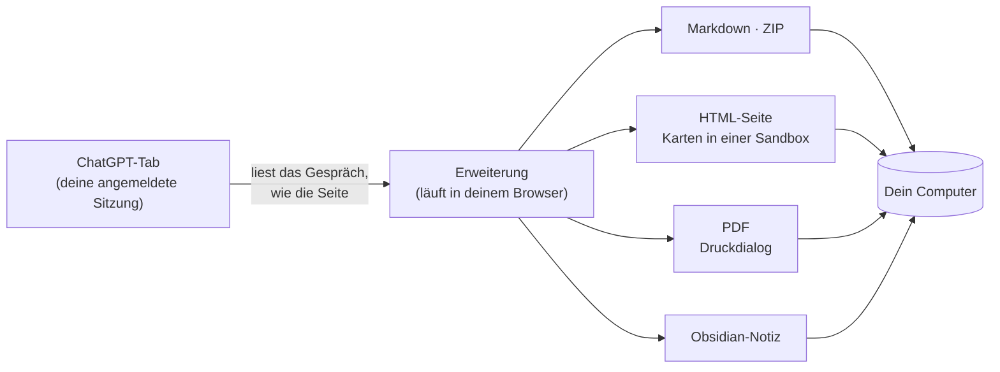

  

<h1 align="center">Chat &amp; Intelligent UI Exporter for ChatGPT</h1>

  Speichere ChatGPT-Gespräche samt ihren interaktiven <b>Intelligent-UI</b>-Karten 
  als Markdown, HTML, PDF oder direkt in Obsidian. Alles passiert auf deinem Computer.

  
  
  
  
  

  <a href="../../README.md">English</a> ·
  <a href="README.zh-CN.md">简体中文</a> ·
  <a href="README.zh-TW.md">繁體中文</a> ·
  <a href="README.ja.md">日本語</a> ·
  <a href="README.ko.md">한국어</a> ·
  <a href="README.es.md">Español</a> ·
  <a href="README.pt-BR.md">Português</a> ·
  <a href="README.fr.md">Français</a> ·
  <b>Deutsch</b> ·
  <a href="README.ru.md">Русский</a>

  <a href="#installation">Installation</a> ·
  <a href="#was-du-bekommst">Was du bekommst</a> ·
  <a href="#schnellstart">Schnellstart</a> ·
  <a href="#häufige-fragen">Häufige Fragen</a> ·
  <a href="../../PRIVACY.md">Datenschutz</a> ·
  <a href="#feedback">Feedback</a>

  

> Die Screenshots zeigen die englische Oberfläche; die Erweiterung folgt der Sprache deines Browsers.

## Warum es das gibt

ChatGPT-Antworten sind längst nicht mehr nur Text. Sie enthalten Tabellen, Formeln, erzeugte Bilder, Dateien aus dem Code-Interpreter und immer öfter **interaktive Karten** (Intelligent UI) mit Tabs, Schiebereglern und Schaltflächen. Kopieren und Einfügen verliert das meiste davon, und der Datenexport von ChatGPT liefert rohes JSON.

Diese Erweiterung liest das Gespräch so, wie die ChatGPT-Seite es tut, und schreibt es vollständig heraus:

- **Nichts geht verloren.** Der Text bleibt bearbeitbar, Originalbilder und Dateien werden heruntergeladen, und jede Karte wird als Bild *und* als Text gespeichert, also durchsuchbar.
- **Karten funktionieren weiter.** Im HTML-Export laufen sie erneut: Tab wechseln, Regler verschieben, die Zahlen ändern sich.
- **Privat von Grund auf.** Kein Server, kein Konto, keine Statistik, keine KI-Aufrufe. Siehe [PRIVACY.md](../../PRIVACY.md) (Englisch und Chinesisch).

## Was du bekommst

| Format | Datei | Gut für |
| --- | --- | --- |
| **Nur Text** | `.md` | Notiz-Apps, schnelle Kopien. Markdown mit Tabellen, Code, Formeln und Quellenlinks. |
| **Gesamtarchiv** | `.zip` | Alles behalten: Markdown plus Originalbilder, Kartenbilder, angehängte und erzeugte Dateien. |
| **HTML-Seite** | `.html` (oder `.html.zip`) | Lesen und teilen. Sieht aus wie ChatGPT, und die Karten sind interaktiv. |
| **PDF (Drucken)** | über den Druckdialog | Drucken und abgeben. Echter Text zum Markieren und Durchsuchen, A4-Layout. |
| **Obsidian** | eine Notiz in deinem Vault | Speichert in einen Ordner deiner Wahl und öffnet die Notiz. |

Du kannst ein ganzes Gespräch exportieren oder nur angehakte Nachrichten, aus gespeicherten Chats (`/c/…`) und aus geteilten Links (`/share/…`). Lange Gespräche dauern meist etwa eine Sekunde, auch wenn der Tab im Hintergrund ist.

### Intelligent-UI-Karten, auf zwei Arten gesichert

<table>
  <tr>
    <td width="50%" valign="top">
      <b>HTML-Seite: die Karte funktioniert noch</b>  
      
    </td>
    <td width="50%" valign="top">
      <b>Markdown: ein Bild plus durchsuchbarer Text</b>  
      
<pre lang="markdown">

&gt; [!note]- Kartentext
&gt; **Kyoto trip budget** · [Estimate]
&gt; Optionen: Budget / **Comfort** / Luxury
&gt; | Item  | Per day | Total |
&gt; | Hotel | \$160   | \$480 |
&gt; …</pre>
    </td>
  </tr>
</table>

Text, den eine Karte nur in einem anderen Zustand zeigt (ein anderer Tab, ein geöffneter Abschnitt), steht unter *Karteninhalt in anderen Zuständen*, damit nichts hinter einem Klick verborgen bleibt. Die Einzelheiten jedes Formats stehen in [docs/export-formats.md](../export-formats.md) (Englisch).

## Installation

> [!NOTE]
> Der Eintrag im Chrome Web Store ist unterwegs. Bis dahin lädst du die Erweiterung aus diesem Repository.

1. Lade dieses Repository herunter ([**Code → Download ZIP**](https://github.com/letheli710/chat-intelligent-ui-exporter/archive/refs/heads/main.zip)) und entpacke es, oder nutze `git clone`.
2. Öffne `chrome://extensions` und schalte oben rechts den **Entwicklermodus** ein.
3. Klicke auf **Entpackte Erweiterung laden** und wähle den Ordner `extension`.
4. Öffne ein Gespräch auf [chatgpt.com](https://chatgpt.com). Neben dem Eingabefeld erscheinen zwei Schaltflächen.

Für Chrome gemacht. Andere Chromium-Browser mit Manifest V3 (Edge, Brave) sollten auch funktionieren, sind aber nicht getestet.

## Schnellstart

1. **Öffne ein ChatGPT-Gespräch.**
2. **Klicke auf die Export-Schaltfläche** neben dem Eingabefeld oder auf das Erweiterungssymbol in der Symbolleiste.
3. **Wähle ein Format** im Menü daneben. Die Wahl wird gemerkt.
4. Nur einen Teil? Öffne die **Seitenleiste** (die Listen-Schaltfläche oder <kbd>Alt</kbd>+<kbd>Shift</kbd>+<kbd>E</kbd>), hake die Nachrichten an und klicke auf **Exportieren**.

Die Datei landet in deinem Download-Ordner (oder wo du willst, siehe *Einstellungen*). Für Obsidian wählst du einmal deinen Notizordner; danach schreibt **Speichern** die Notiz und **Öffnen** springt zu ihr.

 

  

## So funktioniert es

- Die Erweiterung holt das Gespräch von der ChatGPT-Website selbst, mit der Anmeldung, die dein Browser schon hat. Sie scrollt die Seite nicht und macht keine Bildschirmfotos davon.
- Karten werden gezeichnet, indem ihr Programm in einer abgeschotteten Sandbox-Seite in der Erweiterung läuft, deshalb sieht das Bild aus wie bei ChatGPT.
- Nichts geht an einen Server von uns, denn es gibt keinen.

## Einstellungen

Öffne sie über das Zahnrad in der Seitenleiste, das Symbolleisten-Fenster oder die Optionsseite der Erweiterung. Das ⓘ neben einer Einstellung erklärt sie; manche öffnen eine Seite mit Beispielen.

<b>Die Einstellungsseite ansehen</b>

 

| Einstellung | Was sie ändert |
| --- | --- |
| **Gedacht für**: Allgemein / Obsidian | Allgemein zeigt HTML, das ChatGPT in eine Antwort schreibt, als Text, damit es überall gleich aussieht; Obsidian lässt es funktionieren (einklappbare Blöcke, kleine Bilder). |
| **Form der HTML-Seite** | Eine Datei (Standard, leicht zu verschicken) oder eine ZIP mit Ordnern (kleinere Seite, besser bei vielen Bildern). [Mehr](../export-formats.md#html-page) |
| **Dateinamenformat** | Titel, Titel und Datum, Datum und Titel oder ein eigenes Präfix. |
| **Markdown-Inhalt** | Obsidian-Eigenschaften (Titel, Quelle, Zeit, Modell), Zeit der Nachrichten, Rollennamen. |
| **Bildkarten als HTML** (Beta) | Schreibt Bild-und-Text-Listenkarten als HTML nebeneinander statt als Tabelle. |
| **Bei jedem Export Speicherort wählen** | Fragt bei jedem Export nach einem Ordner, statt Downloads zu nutzen. |
| **Sprache** | Folgt deinem Browser, oder wähle eine von 10 Sprachen. |

## Datenschutz und Berechtigungen

Die Erweiterung schickt deine Gespräche nirgendwohin. Die vollständige Richtlinie steht in [PRIVACY.md](../../PRIVACY.md); kurz:

| Berechtigung | Wozu |
| --- | --- |
| `chatgpt.com`, `chat.openai.com` | Die Schaltflächen anzeigen und das Gespräch lesen, das du gerade ansiehst. |
| `images.openai.com` | Bilder aus Suchergebnissen herunterladen, ohne Cookies. |
| `scripting` | Das Fenster in ChatGPT-Tabs einfügen, die beim Installieren oder Aktualisieren schon offen waren. |
| `downloads` | Die exportierte Datei speichern. |
| `storage` | Deine Einstellungen merken, nur auf deinem Computer. |

> [!TIP]
> Eine exportierte HTML-Seite verhält sich wie jede Webseite: Verweist der Chat selbst auf Bilder oder Apps im Web, lädt dein Browser sie beim Öffnen der Datei. Die Karte bleibt offline, bis du auf *Verschiebbare Karte online öffnen* klickst.

## Häufige Fragen

<b>Das Tastenkürzel tut nichts oder öffnet das Symbolleisten-Fenster statt der Seitenleiste.</b>

Chrome vergibt das vorgeschlagene <kbd>Alt</kbd>+<kbd>Shift</kbd>+<kbd>E</kbd> nur bei der ersten Installation und nicht, wenn eine andere Erweiterung diese Tasten schon nutzt. Öffne `chrome://extensions/shortcuts` und belege die Zeile **Export-Seitenleiste öffnen / schließen**. Die andere Zeile, die von Chrome selbst, öffnet das Symbolleisten-Fenster. In den Einstellungen der Erweiterung siehst du, welche Taste gerade belegt ist.

<b>Eine HTML-Datei oder ZIP?</b>

Beide sehen gleich aus und funktionieren gleich. Eine Datei ist am leichtesten zu verschicken, aber etwa ein Drittel größer als die Bilder darin. Bei vielen Bildern öffnet die ZIP schneller und du kannst die Originale herausnehmen. Hat ein Chat mehr als 10 Bilder und Dateien, schlägt die Erweiterung ZIP vor, einen Klick entfernt.

<b>Teile einer Antwort sind auf der HTML-Seite durch einen „Removed“-Kasten ersetzt.</b>

Wenn das HTML, das ChatGPT schreibt, erhalten bleibt, wird alles entfernt, was Code ausführen könnte (eingebettete Seiten, Player, Formulare, Skript-Links), bevor es in deine Datei kommt. Der Kasten sagt, was entfernt wurde, und verlinkt [docs/html-filter.md](../html-filter.md) (Englisch), wo jeder Fall erklärt ist.

<b>Werden auch die anderen Antworten exportiert, die ich neu erzeugt habe?</b>

Noch nicht: nur die Antwort, die gerade auf der Seite steht. Karten werden in ihrem Standardzustand exportiert, weil ChatGPT nicht speichert, was du angeklickt hast; die anderen Zustände stehen als Text dabei.

<b>In meiner Markdown-App fehlen die Bilder.</b>

Lass `conversation.md` neben seinem Ordner `assets/`; die Bilder sind relativ verlinkt. Nimm **Gesamtarchiv (.zip)**, um die Bilder zu bekommen; **Nur Text** schreibt nur das Markdown.

<b>Funktioniert es mit geteilten Links und dem kostenlosen Tarif?</b>

Ja. Gespeicherte Chats und geteilte Links, in jedem Tarif. Für deine eigenen Chats musst du angemeldet sein; geteilte Links gehen auch ohne Anmeldung, solange ChatGPT sie anzeigt.

<b>Wird irgendetwas an OpenAI oder an dich geschickt?</b>

Die Erweiterung spricht nur mit der ChatGPT-Website, um das Gespräch zu lesen, das du exportieren willst, so wie die Seite selbst. An den Entwickler geht nichts. Der Link *Problem melden* öffnet ein Google-Formular, und es wird nichts gesendet, solange du es nicht abschickst.

## Dokumentation

- [Die Exportformate im Detail](../export-formats.md) (Englisch): was jedes Format enthält, der Aufbau der ZIP, wie Karten, Landkarten, eingebettete Apps und PDF-Seiten behandelt werden.
- [Was der HTML-Export entfernt, und warum](../html-filter.md) (Englisch)
- [Datenschutzerklärung](../../PRIVACY.md) (Englisch und Chinesisch)
- [Entwicklungsleitfaden](../DEVELOPMENT.md) (Englisch): Bauen, Tests und Prüfungen, wie die Screenshots oben entstehen.
- [Hinweise zu Drittanbietern](../../extension/THIRD_PARTY_NOTICES.md)

## Feedback

- Etwas kaputt oder verbesserungswürdig? Nutze **Problem melden** unten im Symbolleisten-Fenster. Es öffnet ein [kurzes Formular](https://docs.google.com/forms/d/e/1FAIpQLSemj8AaDckqB2NJ_tsb3VW2jG1AxM-NIrmKJMom8IXtjUYgaQ/viewform), in dem Version und Browser schon eingetragen sind.
- Lieber GitHub? [Eröffne ein Issue](https://github.com/letheli710/chat-intelligent-ui-exporter/issues). Bitte hänge keine echten Gespräche, HAR-Dateien oder Cookies an.
- Pull Requests sind willkommen; fang mit dem [Entwicklungsleitfaden](../DEVELOPMENT.md) an.

## Danksagung

Gebaut mit [marked](https://github.com/markedjs/marked) (Markdown zu HTML), [JSZip](https://stuk.github.io/jszip/) (Archive) und [Lucide](https://lucide.dev) (Kartensymbole). Die Länge der Code-Zäune und das Auslesen von KaTeX-Annotationen sind an [otaliptus/chatgpt-markdown-exporter](https://github.com/otaliptus/chatgpt-markdown-exporter) angelehnt. Die Lizenzen liegen in [extension/licenses](../../extension/licenses).

## Lizenz

[MIT](../../LICENSE). Dieses Projekt steht in keiner Verbindung zu OpenAI und wird von OpenAI weder unterstützt noch gesponsert. ChatGPT ist eine Marke von OpenAI.
