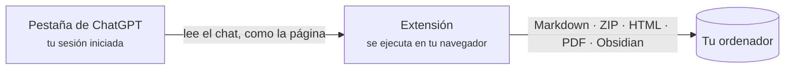

  

<h1 align="center">Chat &amp; Intelligent UI Exporter for ChatGPT</h1>

  Guarda las conversaciones de ChatGPT, con sus tarjetas interactivas de <b>Intelligent UI</b>, 
  como Markdown, HTML, PDF o directamente en Obsidian. Todo ocurre en tu ordenador.

  
  
  
  
  

  <a href="../../README.md">English</a> ·
  <a href="README.zh-CN.md">简体中文</a> ·
  <a href="README.zh-TW.md">繁體中文</a> ·
  <a href="README.ja.md">日本語</a> ·
  <a href="README.ko.md">한국어</a> ·
  <b>Español</b> ·
  <a href="README.pt-BR.md">Português</a> ·
  <a href="README.fr.md">Français</a> ·
  <a href="README.de.md">Deutsch</a> ·
  <a href="README.ru.md">Русский</a>

  <a href="#instalación">Instalación</a> ·
  <a href="#qué-obtienes">Qué obtienes</a> ·
  <a href="#primeros-pasos">Primeros pasos</a> ·
  <a href="#preguntas-frecuentes">Preguntas frecuentes</a> ·
  <a href="../../PRIVACY.md">Privacidad</a> ·
  <a href="#comentarios">Comentarios</a>

  

> Las capturas muestran la interfaz en inglés; la extensión sigue el idioma de tu navegador.

## Por qué existe

Las respuestas de ChatGPT ya no son solo texto. Tienen tablas, fórmulas, imágenes generadas, archivos del intérprete de código y, cada vez más, **tarjetas interactivas** (Intelligent UI) con pestañas, deslizadores y botones. Copiar y pegar pierde casi todo eso, y la exportación de datos de ChatGPT te da JSON sin procesar.

Esta extensión lee la conversación igual que la página de ChatGPT y la guarda completa:

- **No se pierde nada.** El texto sigue siendo editable, las imágenes y archivos originales se descargan, y cada tarjeta se guarda como imagen *y* como texto, así que se puede buscar.
- **Las tarjetas siguen funcionando.** En la exportación HTML vuelven a ejecutarse: cambia de pestaña, mueve el deslizador y mira cómo cambian los números.
- **Privada desde el diseño.** Sin servidor, sin cuenta, sin analítica, sin llamadas a IA. Consulta [PRIVACY.md](../../PRIVACY.md) (en inglés y chino).

## Qué obtienes

| Formato | Archivo | Ideal para |
| --- | --- | --- |
| **Markdown solo texto** | `.md` | Apps de notas y copias rápidas. Markdown con tablas, código, fórmulas y enlaces a fuentes. |
| **Paquete Markdown** | `.zip` | Conservarlo todo: Markdown más imágenes originales, imágenes de tarjetas y archivos adjuntos o generados. |
| **Página HTML** | `.html` (o `.html.zip`) | Leer y compartir. Se parece a ChatGPT y las tarjetas son interactivas. |
| **PDF (imprimir)** | desde el diálogo de impresión | Imprimir y entregar. Texto real que se puede seleccionar y buscar, en A4. |
| **Obsidian** | una nota en tu bóveda | Guarda en la carpeta que elijas y abre la nota. |

Puedes exportar la conversación entera o solo los mensajes que marques, tanto de chats guardados (`/c/…`) como de enlaces compartidos (`/share/…`). Las conversaciones largas suelen tardar alrededor de un segundo, aunque la pestaña esté en segundo plano.

### Tarjetas de Intelligent UI, guardadas de dos maneras

<table>
  <tr>
    <td width="50%" valign="top">
      <b>Página HTML: la tarjeta sigue funcionando</b>  
      
    </td>
    <td width="50%" valign="top">
      <b>Markdown: una imagen y texto que se puede buscar</b>  
      
<pre lang="markdown">

&gt; [!note]- Texto de la tarjeta
&gt; **Kyoto trip budget** · [Estimate]
&gt; Opciones: Budget / **Comfort** / Luxury
&gt; | Item  | Per day | Total |
&gt; | Hotel | \$160   | \$480 |
&gt; …</pre>
    </td>
  </tr>
</table>

El texto que una tarjeta solo muestra en otro estado (otra pestaña, una sección abierta) aparece en *Contenido de la tarjeta en otros estados*, así que nada queda escondido tras un clic. Los detalles de cada formato están en [docs/export-formats.md](../export-formats.md) (en inglés).

## Instalación

> [!NOTE]
> La ficha en Chrome Web Store está en camino. Mientras tanto, carga la extensión desde este repositorio.

1. Descarga este repositorio ([**Code → Download ZIP**](https://github.com/letheli710/chat-intelligent-ui-exporter/archive/refs/heads/main.zip)) y descomprímelo, o haz `git clone`.
2. Abre `chrome://extensions` y activa el **Modo de desarrollador** (arriba a la derecha).
3. Pulsa **Cargar descomprimida** y elige la carpeta `extension`.
4. Abre una conversación en [chatgpt.com](https://chatgpt.com). Aparecen dos botones junto al cuadro de texto.

Hecha para Chrome. Otros navegadores Chromium con Manifest V3 (Edge, Brave) deberían funcionar, pero no están probados.

## Primeros pasos

1. **Abre una conversación de ChatGPT.**
2. **Pulsa el botón de exportar** junto al cuadro de texto, o el icono de la extensión en la barra de herramientas.
3. **Elige un formato** en el menú de al lado. La elección se recuerda.
4. ¿Solo una parte? Abre la **barra lateral** (el botón de lista, o <kbd>Alt</kbd>+<kbd>Shift</kbd>+<kbd>E</kbd>), marca los mensajes y pulsa **Exportar**.

El archivo va a tu carpeta de Descargas (o donde elijas; ver *Ajustes*). Para Obsidian, eliges tu carpeta de notas una vez; después, **Guardar** escribe la nota y **Abrir** salta a ella.

 

  

## Cómo funciona

- La extensión pide la conversación al propio sitio de ChatGPT, con la sesión que tu navegador ya tiene. No desplaza la página ni hace capturas de ella.
- Las tarjetas se dibujan ejecutando su programa en una página aislada (sandbox) dentro de la extensión, así que la imagen coincide con lo que muestra ChatGPT.
- Nada va a un servidor nuestro, porque no lo hay.

## Ajustes

Ábrelos desde el engranaje de la barra lateral, el panel de la barra de herramientas o la página de opciones de la extensión. El ⓘ junto a cada ajuste lo explica; algunos abren una página con ejemplos.

<b>Ver la página de ajustes</b>

 

| Ajuste | Qué cambia |
| --- | --- |
| **Pensado para**: Genérico / Obsidian | Genérico muestra como texto el HTML que ChatGPT escribe dentro de una respuesta, para que se lea igual en cualquier sitio; Obsidian lo deja funcionando (bloques plegables, imágenes pequeñas). |
| **Forma de la página HTML** | Un archivo (predeterminado, fácil de enviar) o un ZIP con carpetas (página más ligera, mejor con muchas imágenes). [Más](../export-formats.md#html-page) |
| **Formato del nombre** | Título, título y fecha, fecha y título, o un prefijo propio. |
| **Contenido Markdown** | Propiedades de Obsidian (título, fuente, hora, modelo), hora de los mensajes, nombres de los roles. |
| **Tarjetas con imágenes como HTML** (Beta) | Escribe las tarjetas de lista con imagen y texto como HTML lado a lado en vez de tabla. |
| **Elegir dónde guardar en cada exportación** | Pregunta la carpeta cada vez en lugar de usar Descargas. |
| **Idioma** | Sigue a tu navegador, o elige uno de 10 idiomas. |

## Privacidad y permisos

La extensión nunca envía tus conversaciones a ningún sitio. La política completa está en [PRIVACY.md](../../PRIVACY.md); en resumen:

| Permiso | Para qué |
| --- | --- |
| `chatgpt.com`, `chat.openai.com` | Mostrar los botones y leer la conversación que estás viendo. |
| `images.openai.com` | Descargar las imágenes de los resultados de búsqueda, sin cookies. |
| `scripting` | Añadir el panel a las pestañas de ChatGPT que ya estaban abiertas al instalar o actualizar la extensión. |
| `downloads` | Guardar el archivo exportado. |
| `storage` | Recordar tus ajustes, solo en tu ordenador. |

> [!TIP]
> Una página HTML exportada se comporta como cualquier página web: si el propio chat apunta a imágenes o apps en la web, tu navegador las carga al abrir el archivo. El mapa sigue sin conexión salvo que pulses *Abrir el mapa interactivo en línea*.

## Preguntas frecuentes

<b>El atajo de teclado no hace nada, o abre el panel de la barra de herramientas en vez de la barra lateral.</b>

Chrome solo asigna el atajo sugerido <kbd>Alt</kbd>+<kbd>Shift</kbd>+<kbd>E</kbd> al instalar la extensión por primera vez, y no si otra extensión ya usa esas teclas. Abre `chrome://extensions/shortcuts` y configura la fila **Abrir / cerrar la barra lateral de exportación**. La otra fila, la propia de Chrome, abre el panel de la barra de herramientas. Los ajustes de la extensión muestran qué tecla está asignada ahora.

<b>¿Un archivo HTML o ZIP?</b>

Los dos se ven y funcionan igual. Un archivo es lo más fácil de enviar, pero ocupa alrededor de un tercio más que sus imágenes. Con muchas imágenes, el ZIP se abre más rápido y te deja sacar los originales. Cuando un chat tiene más de 10 imágenes y archivos, la extensión te sugiere ZIP, a un clic.

<b>Algunas partes de una respuesta aparecen como un recuadro «Removed» en la página HTML.</b>

Cuando se conserva el HTML que escribe ChatGPT, todo lo que podría ejecutar código (páginas incrustadas, reproductores, formularios, enlaces de script) se elimina antes de entrar en tu archivo. El recuadro dice qué se eliminó y enlaza a [docs/html-filter.md](../html-filter.md) (en inglés), que explica cada caso.

<b>¿Exporta las otras respuestas que regeneré?</b>

Todavía no: solo la respuesta que se muestra en la página. Las tarjetas se exportan en su estado predeterminado, porque ChatGPT no guarda lo que pulsaste; los demás estados se listan como texto.

<b>Las imágenes no aparecen en mi app de Markdown.</b>

Deja `conversation.md` junto a su carpeta `assets/`; las imágenes se enlazan con rutas relativas. Usa **Paquete Markdown (.zip)** para tener las imágenes; **Markdown solo texto** escribe solo el Markdown.

<b>¿Funciona con enlaces compartidos y con el plan gratuito?</b>

Sí. Chats guardados y enlaces compartidos, con cualquier plan. Para tus propios chats necesitas haber iniciado sesión; los enlaces compartidos funcionan sin sesión mientras ChatGPT los muestre.

<b>¿Se envía algo a OpenAI o a ti?</b>

La extensión solo habla con el sitio de ChatGPT para leer la conversación que pediste exportar, igual que hace la propia página. No se envía nada al desarrollador. El enlace *Informar de un problema* abre un formulario de Google, y no se envía nada si no lo envías tú.

## Documentación

- [Formatos de exportación en detalle](../export-formats.md) (en inglés): qué contiene cada formato, la estructura del ZIP, cómo se tratan las tarjetas, mapas, apps incrustadas y páginas PDF.
- [Qué elimina la exportación HTML y por qué](../html-filter.md) (en inglés)
- [Política de privacidad](../../PRIVACY.md) (en inglés y chino)
- [Guía de desarrollo](../DEVELOPMENT.md) (en inglés): compilación, pruebas y comprobaciones, cómo se hacen las capturas de arriba.
- [Avisos de terceros](../../extension/THIRD_PARTY_NOTICES.md)

## Comentarios

- ¿Algo falla o podría ir mejor? Usa **Informar de un problema** al pie del panel de la barra de herramientas. Abre un [formulario breve](https://docs.google.com/forms/d/e/1FAIpQLSemj8AaDckqB2NJ_tsb3VW2jG1AxM-NIrmKJMom8IXtjUYgaQ/viewform) con tu versión y navegador ya rellenados.
- ¿Prefieres GitHub? [Abre un issue](https://github.com/letheli710/chat-intelligent-ui-exporter/issues). Por favor, no adjuntes conversaciones reales, archivos HAR ni cookies.
- Los pull requests son bienvenidos; empieza por la [guía de desarrollo](../DEVELOPMENT.md).

## Agradecimientos

Hecha con [marked](https://github.com/markedjs/marked) (Markdown a HTML), [JSZip](https://stuk.github.io/jszip/) (archivos comprimidos) y [Lucide](https://lucide.dev) (iconos de las tarjetas). El cálculo de las vallas de código y la extracción de anotaciones KaTeX se basan en [otaliptus/chatgpt-markdown-exporter](https://github.com/otaliptus/chatgpt-markdown-exporter). Las licencias están en [extension/licenses](../../extension/licenses).

## Licencia

[MIT](../../LICENSE). Este proyecto no está afiliado a OpenAI ni cuenta con su respaldo o patrocinio. ChatGPT es una marca de OpenAI.
