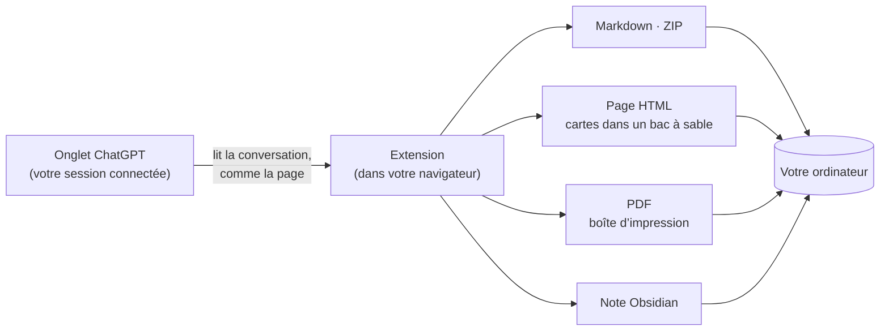

  

<h1 align="center">Chat &amp; Intelligent UI Exporter for ChatGPT</h1>

  Enregistrez vos conversations ChatGPT, avec leurs cartes interactives <b>Intelligent UI</b>, 
  en Markdown, HTML, PDF ou directement dans Obsidian. Tout se passe sur votre ordinateur.

  
  
  
  
  

  <a href="../../README.md">English</a> ·
  <a href="README.zh-CN.md">简体中文</a> ·
  <a href="README.zh-TW.md">繁體中文</a> ·
  <a href="README.ja.md">日本語</a> ·
  <a href="README.ko.md">한국어</a> ·
  <a href="README.es.md">Español</a> ·
  <a href="README.pt-BR.md">Português</a> ·
  <b>Français</b> ·
  <a href="README.de.md">Deutsch</a> ·
  <a href="README.ru.md">Русский</a>

  <a href="#installation">Installation</a> ·
  <a href="#ce-que-vous-obtenez">Ce que vous obtenez</a> ·
  <a href="#prise-en-main">Prise en main</a> ·
  <a href="#questions-fréquentes">Questions fréquentes</a> ·
  <a href="../../PRIVACY.md">Confidentialité</a> ·
  <a href="#vos-retours">Vos retours</a>

  

> Les captures montrent l’interface en anglais ; l’extension suit la langue de votre navigateur.

## Pourquoi cette extension

Les réponses de ChatGPT ne sont plus seulement du texte. Elles contiennent des tableaux, des formules, des images générées, des fichiers de l’interpréteur de code et, de plus en plus, des **cartes interactives** (Intelligent UI) avec onglets, curseurs et boutons. Le copier-coller en perd l’essentiel, et l’export de données de ChatGPT vous donne du JSON brut.

Cette extension lit la conversation comme le fait la page ChatGPT, puis l’enregistre en entier :

- **Rien ne se perd.** Le texte reste modifiable, les images et fichiers d’origine sont téléchargés, et chaque carte est gardée en image *et* en texte, donc consultable par recherche.
- **Les cartes fonctionnent encore.** Dans l’export HTML, elles se relancent : changez d’onglet, déplacez le curseur, les chiffres suivent.
- **Confidentielle par conception.** Pas de serveur, pas de compte, pas de statistiques, pas d’appel à une IA. Voir [PRIVACY.md](../../PRIVACY.md) (en anglais et en chinois).

## Ce que vous obtenez

| Format | Fichier | Idéal pour |
| --- | --- | --- |
| **Texte seul** | `.md` | Applis de notes, copies rapides. Du Markdown avec tableaux, code, formules et liens vers les sources. |
| **Archive complète** | `.zip` | Tout garder : le Markdown plus les images d’origine, les images des cartes, les fichiers joints et générés. |
| **Page HTML** | `.html` (ou `.html.zip`) | Lire et partager. Ressemble à ChatGPT, et les cartes sont interactives. |
| **PDF (impression)** | via la boîte de dialogue d’impression | Imprimer et rendre. Du vrai texte, sélectionnable et consultable, mis en page en A4. |
| **Obsidian** | une note dans votre coffre | Enregistre dans le dossier choisi et ouvre la note. |

Vous pouvez exporter toute la conversation ou seulement les messages cochés, depuis les conversations enregistrées (`/c/…`) comme depuis les liens partagés (`/share/…`). Les longues conversations prennent en général environ une seconde, même quand l’onglet est en arrière-plan.

### Les cartes Intelligent UI, gardées de deux façons

<table>
  <tr>
    <td width="50%" valign="top">
      <b>Page HTML : la carte fonctionne toujours</b>  
      
    </td>
    <td width="50%" valign="top">
      <b>Markdown : une image et du texte consultable</b>  
      
<pre lang="markdown">

&gt; [!note]- Texte de la carte
&gt; **Kyoto trip budget** · [Estimate]
&gt; Options : Budget / **Comfort** / Luxury
&gt; | Item  | Per day | Total |
&gt; | Hotel | \$160   | \$480 |
&gt; …</pre>
    </td>
  </tr>
</table>

Le texte qu’une carte n’affiche que dans un autre état (un autre onglet, une section ouverte) est repris sous *Contenu de la carte dans d’autres états* : rien ne reste caché derrière un clic. Le détail de chaque format se trouve dans [docs/export-formats.md](../export-formats.md) (en anglais).

## Installation

> [!NOTE]
> La fiche sur le Chrome Web Store arrive bientôt. En attendant, chargez l’extension depuis ce dépôt.

1. Téléchargez ce dépôt ([**Code → Download ZIP**](https://github.com/letheli710/chat-intelligent-ui-exporter/archive/refs/heads/main.zip)) et décompressez-le, ou faites un `git clone`.
2. Ouvrez `chrome://extensions` et activez le **Mode développeur** (en haut à droite).
3. Cliquez sur **Charger l’extension non empaquetée** et choisissez le dossier `extension`.
4. Ouvrez une conversation sur [chatgpt.com](https://chatgpt.com). Deux boutons apparaissent à côté de la zone de saisie.

Conçue pour Chrome. Les autres navigateurs Chromium compatibles Manifest V3 (Edge, Brave) devraient fonctionner, mais ne sont pas testés.

## Prise en main

1. **Ouvrez une conversation ChatGPT.**
2. **Cliquez sur le bouton d’export** à côté de la zone de saisie, ou sur l’icône de l’extension dans la barre d’outils.
3. **Choisissez un format** dans le menu voisin. Le choix est mémorisé.
4. Seulement une partie ? Ouvrez le **panneau latéral** (le bouton liste, ou <kbd>Alt</kbd>+<kbd>Shift</kbd>+<kbd>E</kbd>), cochez les messages, puis **Exporter**.

Le fichier va dans votre dossier Téléchargements (ou là où vous le choisissez, voir *Réglages*). Pour Obsidian, vous choisissez une fois votre dossier de notes ; ensuite, **Enregistrer** écrit la note et **Ouvrir** y mène directement.

 

  

## Comment ça marche

- L’extension demande la conversation au site de ChatGPT lui-même, avec la connexion que votre navigateur a déjà. Elle ne fait pas défiler la page et n’en prend pas de capture.
- Les cartes sont dessinées en exécutant leur programme dans une page isolée (bac à sable) au sein de l’extension : l’image correspond à ce qu’affiche ChatGPT.
- Rien ne part vers un serveur à nous : il n’y en a pas.

## Réglages

Ouvrez-les depuis la roue dentée du panneau latéral, le panneau de la barre d’outils ou la page d’options de l’extension. Le ⓘ à côté d’un réglage l’explique ; certains ouvrent une page avec des exemples.

<b>Voir la page des réglages</b>

 

| Réglage | Ce qu’il change |
| --- | --- |
| **Destiné à** : Générique / Obsidian | Générique affiche en texte le HTML que ChatGPT écrit dans une réponse, pour un rendu identique partout ; Obsidian le garde fonctionnel (blocs repliables, petites images). |
| **Forme de la page HTML** | Un fichier (par défaut, facile à envoyer) ou un ZIP avec dossiers (page plus légère, mieux avec beaucoup d’images). [En savoir plus](../export-formats.md#html-page) |
| **Format du nom** | Titre, titre et date, date et titre, ou un préfixe à vous. |
| **Contenu Markdown** | Propriétés Obsidian (titre, source, heure, modèle), heure des messages, noms des rôles. |
| **Cartes à images en HTML** (Beta) | Écrit les cartes « image + texte » en HTML côte à côte au lieu d’un tableau. |
| **Choisir l’emplacement à chaque export** | Demande un dossier à chaque export au lieu d’utiliser Téléchargements. |
| **Langue** | Suit votre navigateur, ou choisissez parmi 10 langues. |

## Confidentialité et autorisations

L’extension n’envoie jamais vos conversations nulle part. La politique complète est dans [PRIVACY.md](../../PRIVACY.md) ; en bref :

| Autorisation | Pourquoi |
| --- | --- |
| `chatgpt.com`, `chat.openai.com` | Afficher les boutons et lire la conversation que vous regardez. |
| `images.openai.com` | Télécharger les images des résultats de recherche, sans cookies. |
| `scripting` | Ajouter le panneau aux onglets ChatGPT déjà ouverts lors de l’installation ou de la mise à jour. |
| `downloads` | Enregistrer le fichier exporté. |
| `storage` | Mémoriser vos réglages, uniquement sur votre ordinateur. |

> [!TIP]
> Une page HTML exportée se comporte comme n’importe quelle page web : si la conversation elle-même renvoie à des images ou à des applis en ligne, votre navigateur les charge à l’ouverture du fichier. La carte reste hors ligne tant que vous ne cliquez pas sur *Ouvrir la carte déplaçable en ligne*.

## Questions fréquentes

<b>Le raccourci clavier ne fait rien, ou ouvre le panneau de la barre d’outils au lieu du panneau latéral.</b>

Chrome n’attribue le raccourci suggéré <kbd>Alt</kbd>+<kbd>Shift</kbd>+<kbd>E</kbd> qu’à la première installation, et pas si une autre extension utilise déjà ces touches. Ouvrez `chrome://extensions/shortcuts` et réglez la ligne **Ouvrir / fermer le panneau latéral d’export**. L’autre ligne, celle de Chrome, ouvre le panneau de la barre d’outils. Les réglages de l’extension indiquent la touche actuellement attribuée.

<b>Un fichier HTML ou un ZIP ?</b>

Les deux s’affichent et fonctionnent de la même façon. Un fichier est le plus simple à envoyer, mais pèse environ un tiers de plus que ses images. Avec beaucoup d’images, le ZIP s’ouvre plus vite et vous laisse récupérer les originaux. Quand une conversation contient plus de 10 images et fichiers, l’extension vous propose le ZIP, en un clic.

<b>Certaines parties d’une réponse sont remplacées par un cadre « Removed » dans la page HTML.</b>

Quand le HTML écrit par ChatGPT est conservé, tout ce qui pourrait exécuter du code (pages intégrées, lecteurs, formulaires, liens de script) est retiré avant d’entrer dans votre fichier. Le cadre indique ce qui a été retiré et renvoie à [docs/html-filter.md](../html-filter.md) (en anglais), qui explique chaque cas.

<b>Les autres réponses que j’ai régénérées sont-elles exportées ?</b>

Pas encore : seule la réponse affichée sur la page l’est. Les cartes sont exportées dans leur état par défaut, car ChatGPT n’enregistre pas ce que vous avez cliqué ; les autres états sont listés en texte.

<b>Les images manquent dans mon appli Markdown.</b>

Gardez `conversation.md` à côté de son dossier `assets/` ; les images sont liées en chemins relatifs. Utilisez **Archive complète (.zip)** pour avoir les images ; **Texte seul** n’écrit que le Markdown.

<b>Est-ce que ça marche avec les liens partagés et l’offre gratuite ?</b>

Oui. Conversations enregistrées et liens partagés, quelle que soit l’offre. Vos propres conversations demandent d’être connecté ; les liens partagés fonctionnent sans connexion tant que ChatGPT les affiche.

<b>Quelque chose est-il envoyé à OpenAI ou à vous ?</b>

L’extension ne parle qu’au site de ChatGPT, pour lire la conversation que vous avez demandé d’exporter, comme le fait la page elle-même. Rien n’est envoyé au développeur. Le lien *Signaler un problème* ouvre un formulaire Google, et rien n’est envoyé tant que vous ne le soumettez pas.

## Documentation

- [Les formats d’export en détail](../export-formats.md) (en anglais) : contenu de chaque format, structure du ZIP, traitement des cartes, cartes géographiques, applis intégrées et pages PDF.
- [Ce que l’export HTML retire, et pourquoi](../html-filter.md) (en anglais)
- [Politique de confidentialité](../../PRIVACY.md) (en anglais et en chinois)
- [Guide de développement](../DEVELOPMENT.md) (en anglais) : compilation, tests et vérifications, fabrication des captures ci-dessus.
- [Mentions tierces](../../extension/THIRD_PARTY_NOTICES.md)

## Vos retours

- Un problème ou une idée ? Utilisez **Signaler un problème** en bas du panneau de la barre d’outils. Il ouvre un [court formulaire](https://docs.google.com/forms/d/e/1FAIpQLSemj8AaDckqB2NJ_tsb3VW2jG1AxM-NIrmKJMom8IXtjUYgaQ/viewform) avec votre version et votre navigateur déjà remplis.
- Vous préférez GitHub ? [Ouvrez une issue](https://github.com/letheli710/chat-intelligent-ui-exporter/issues). Merci de ne pas joindre de vraies conversations, de fichiers HAR ni de cookies.
- Les pull requests sont les bienvenues ; commencez par le [guide de développement](../DEVELOPMENT.md).

## Remerciements

Construite avec [marked](https://github.com/markedjs/marked) (Markdown vers HTML), [JSZip](https://stuk.github.io/jszip/) (archives) et [Lucide](https://lucide.dev) (icônes des cartes). Le calcul des clôtures de code et l’extraction des annotations KaTeX s’inspirent de [otaliptus/chatgpt-markdown-exporter](https://github.com/otaliptus/chatgpt-markdown-exporter). Les licences se trouvent dans [extension/licenses](../../extension/licenses).

## Licence

[MIT](../../LICENSE). Ce projet n’est ni affilié à OpenAI, ni approuvé ou parrainé par OpenAI. ChatGPT est une marque d’OpenAI.
