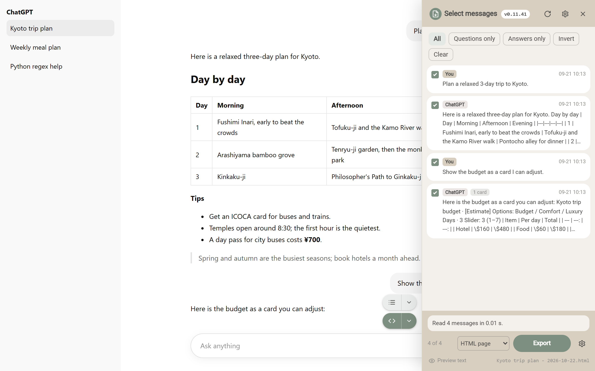
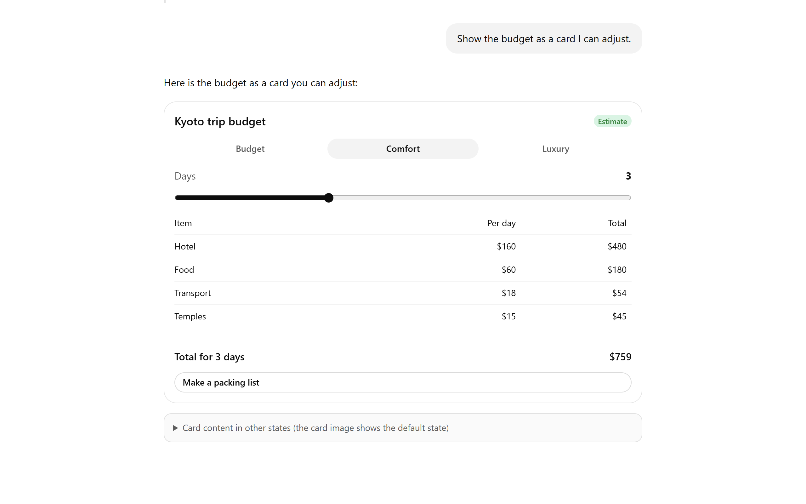
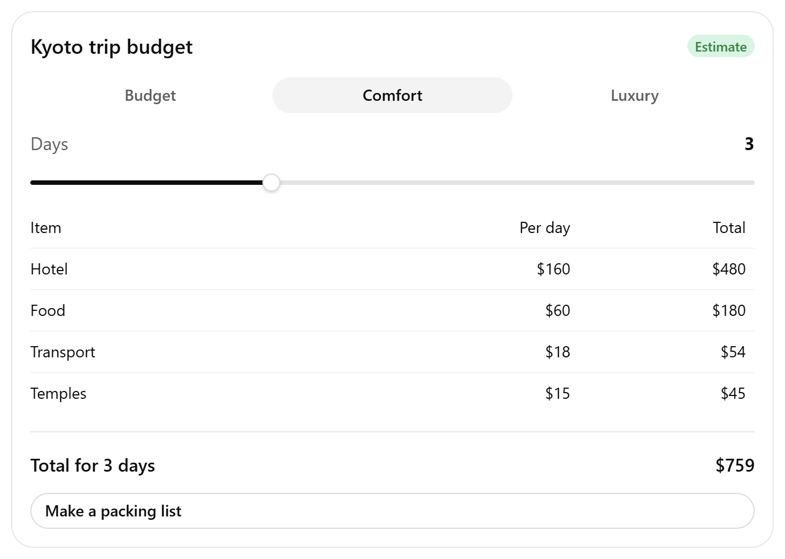
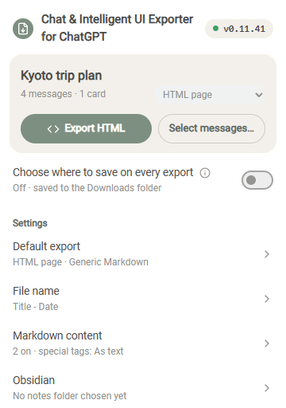
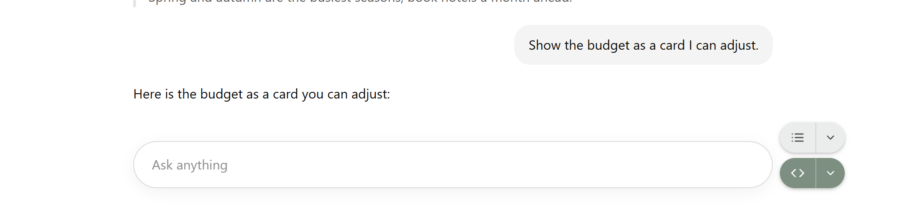
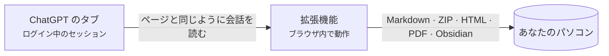
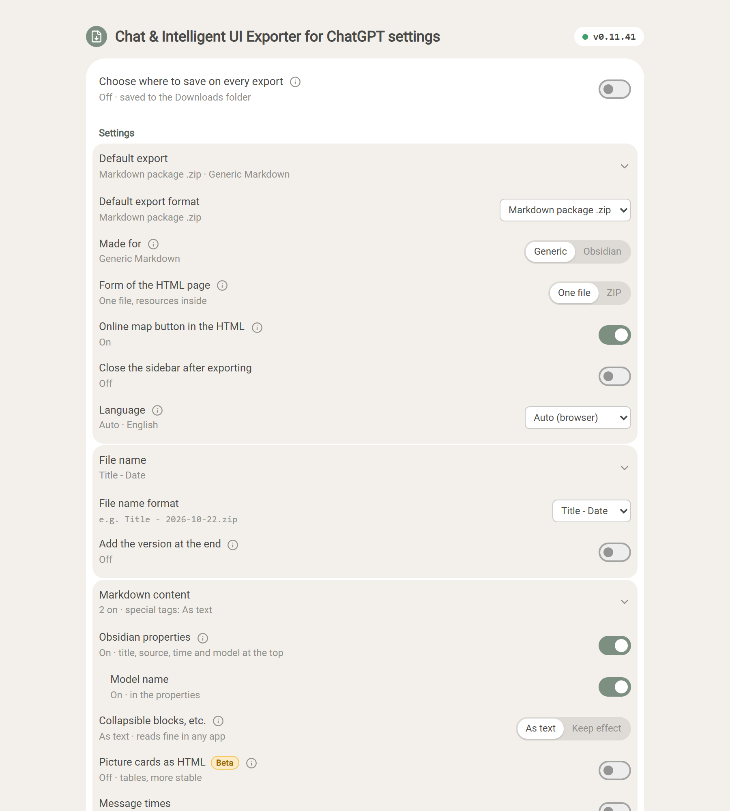

  

<h1 align="center">Chat &amp; Intelligent UI Exporter for ChatGPT</h1>

  ChatGPT の会話を、操作できる <b>Intelligent UI</b> カードごと 
  Markdown・HTML・PDF に保存したり、Obsidian にそのまま保存したりできます。処理はすべてあなたのパソコンの中です。

  
  
  
  
  

  <a href="../../README.md">English</a> ·
  <a href="README.zh-CN.md">简体中文</a> ·
  <a href="README.zh-TW.md">繁體中文</a> ·
  <b>日本語</b> ·
  <a href="README.ko.md">한국어</a> ·
  <a href="README.es.md">Español</a> ·
  <a href="README.pt-BR.md">Português</a> ·
  <a href="README.fr.md">Français</a> ·
  <a href="README.de.md">Deutsch</a> ·
  <a href="README.ru.md">Русский</a>

  <a href="#インストール">インストール</a> ·
  <a href="#できること">できること</a> ·
  <a href="#使い方">使い方</a> ·
  <a href="#よくある質問">よくある質問</a> ·
  <a href="../../PRIVACY.md">プライバシー</a> ·
  <a href="#フィードバック">フィードバック</a>

  

> スクリーンショットは英語の画面です。拡張機能はブラウザの言語に合わせて表示されます。

## なぜ作ったか

ChatGPT の回答は、もう文字だけではありません。表、数式、生成された画像、コードインタープリターが作ったファイル、そしてタブやスライダー、ボタンのある**インタラクティブなカード**（Intelligent UI）が増えています。コピー＆ペーストではその多くが失われ、ChatGPT 標準のデータエクスポートは生の JSON です。

この拡張機能は ChatGPT のページと同じように会話を読み込み、まるごと書き出します。

- **何も失われません。** 本文は編集できるまま、元の画像やファイルはダウンロードされます。カードは画像と文字の両方で残るので、検索もできます。
- **カードがそのまま動きます。** HTML エクスポートではカードがもう一度動きます。タブを切り替えたり、スライダーを動かしたりすると数字が変わります。
- **最初からプライバシー重視。** サーバーなし、アカウント不要、分析なし、AI の呼び出しなし。詳しくは [PRIVACY.md](../../PRIVACY.md)（英語・中国語）。

## できること

| 形式 | ファイル | 向いている用途 |
| --- | --- | --- |
| **Markdown（テキストのみ）** | `.md` | ノートアプリ、手早いコピー。表・コード・数式・出典リンク付きの Markdown。 |
| **Markdown パッケージ** | `.zip` | すべて残す：Markdown に元画像、カード画像、添付や生成されたファイル。 |
| **HTML ページ** | `.html`（または `.html.zip`） | 読む・共有する。ChatGPT に近い見た目で、カードも操作できます。 |
| **PDF（印刷）** | 印刷ダイアログから | 印刷・提出。選択・検索できる本物の文字、A4 レイアウト。 |
| **Obsidian** | 保管庫の 1 つのノート | 選んだフォルダに保存し、ノートを開きます。 |

会話全体でも、チェックしたメッセージだけでもエクスポートできます。保存済みの会話（`/c/…`）も共有リンク（`/share/…`）も対象です。長い会話でもたいてい 1 秒ほどで終わり、タブが裏にあっても動きます。

### Intelligent UI カードを 2 通りで保存

<table>
  <tr>
    <td width="50%" valign="top">
      <b>HTML ページ：カードはそのまま動く</b>  
      
    </td>
    <td width="50%" valign="top">
      <b>Markdown：画像と検索できる文字</b>  
      
<pre lang="markdown">

&gt; [!note]- カードのテキスト
&gt; **Kyoto trip budget** · [Estimate]
&gt; 選択肢：Budget / **Comfort** / Luxury
&gt; | Item  | Per day | Total |
&gt; | Hotel | \$160   | \$480 |
&gt; …</pre>
    </td>
  </tr>
</table>

別の状態でだけ表示される文字（別のタブ、開いたセクション）は「カードの別の状態での内容」にまとめられ、クリックの向こうに隠れたりしません。各形式の詳細は [docs/export-formats.md](../export-formats.md)（英語）へ。

## インストール

> [!NOTE]
> Chrome ウェブストアでの公開を準備中です。それまではこのリポジトリから読み込んでください。

1. このリポジトリをダウンロード（[**Code → Download ZIP**](https://github.com/letheli710/chat-intelligent-ui-exporter/archive/refs/heads/main.zip)）して展開するか、`git clone` します。
2. `chrome://extensions` を開き、右上の**デベロッパー モード**をオンにします。
3. **パッケージ化されていない拡張機能を読み込む**を押し、`extension` フォルダを選びます。
4. [chatgpt.com](https://chatgpt.com) で会話を開くと、入力欄の横にボタンが 2 つ現れます。

Chrome 向けです。Manifest V3 に対応したほかの Chromium 系ブラウザ（Edge、Brave）でも動くはずですが、未検証です。

## 使い方

1. **ChatGPT の会話を開きます。**
2. **入力欄の横のエクスポートボタン**か、ツールバーの拡張機能アイコンを押します。
3. 横のメニューで**形式を選びます**。選んだ形式は記憶されます。
4. 一部だけにしたいときは**サイドバー**を開き（リストのボタン、または <kbd>Alt</kbd>+<kbd>Shift</kbd>+<kbd>E</kbd>）、メッセージにチェックを入れて**エクスポート**します。

ファイルは「ダウンロード」フォルダに保存されます（毎回保存先を選ぶこともできます。「設定」を参照）。Obsidian の場合は最初に一度ノートフォルダを選べば、あとは**保存**でノートを書き込み、**開く**でそのノートに移動します。

 

  

## しくみ

- 拡張機能は、ブラウザがすでに持っているログイン状態で ChatGPT のサイトから会話を読み込みます。ページをスクロールしたり、画面を撮ったりはしません。
- カードは、拡張機能の中の隔離されたサンドボックスページでカードのプログラムを動かして描くので、ChatGPT で見えるものと同じになります。
- 私たちのサーバーに送られることはありません。そもそもサーバーがありません。

## 設定

サイドバーの歯車、ツールバーのパネル、または拡張機能の設定ページから開きます。各項目の ⓘ に説明があり、いくつかは例つきの説明ページを開きます。

<b>設定ページを見る</b>

 

| 設定 | 変わること |
| --- | --- |
| **用途**：汎用 / Obsidian | 汎用は、ChatGPT が回答に書いた HTML を文字として表示し、どのアプリでも同じに見えます。Obsidian はその効果（折りたたみ、小さな画像）を残します。 |
| **HTML ページの形式** | 1 ファイル（既定、送りやすい）か、フォルダ付きの ZIP（ページが小さく、画像が多いときに向く）。[詳しく](../export-formats.md#html-page) |
| **ファイル名の形式** | タイトル、タイトルと日付、日付とタイトル、または自分の接頭辞。 |
| **Markdown の内容** | Obsidian プロパティ（タイトル、出典、日時、モデル）、メッセージの日時、ロール名。 |
| **画像付きカードを HTML で**（Beta） | 画像とテキストのリストカードを、表ではなく左右並びの HTML で書き出します。 |
| **エクスポートのたびに保存先を選ぶ** | 「ダウンロード」ではなく、毎回保存先を尋ねます。 |
| **言語** | ブラウザに合わせるか、10 言語から選びます。 |

## プライバシーと権限

この拡張機能が会話をどこかへ送ることはありません。詳しいポリシーは [PRIVACY.md](../../PRIVACY.md) にあります。要点は次のとおりです。

| 権限 | 必要な理由 |
| --- | --- |
| `chatgpt.com`、`chat.openai.com` | ボタンを表示し、見ている会話を読み込むため。 |
| `images.openai.com` | 検索結果の画像を Cookie なしでダウンロードするため。 |
| `scripting` | 拡張機能のインストールや更新のときに、すでに開いている ChatGPT のタブへパネルを追加するため。 |
| `downloads` | エクスポートしたファイルを保存するため。 |
| `storage` | 設定をあなたのパソコンにだけ記憶するため。 |

> [!TIP]
> エクスポートした HTML ページはふつうのウェブページと同じで、会話そのものがウェブ上の画像やアプリを参照していれば、ファイルを開いたときにブラウザが読み込みます。地図は「ドラッグできる地図をオンラインで開く」を押さない限りオフラインのままです。

## よくある質問

<b>ショートカットが効かない、またはサイドバーではなくツールバーのパネルが開く。</b>

Chrome が推奨キー <kbd>Alt</kbd>+<kbd>Shift</kbd>+<kbd>E</kbd> を割り当てるのは初めてインストールしたときだけで、ほかの拡張機能がそのキーを使っている場合も割り当てません。`chrome://extensions/shortcuts` を開き、「エクスポート用サイドバーの開閉」の行にキーを設定してください。もう一方の Chrome 標準の行はツールバーのパネルを開きます。いま設定されているキーは拡張機能の設定に表示されます。

<b>1 ファイルと ZIP、どちらにする？</b>

どちらも見た目と操作は同じです。1 ファイルは送りやすい反面、中の画像より 3 分の 1 ほど大きくなります。画像が多いなら ZIP のほうが速く開き、元の画像も取り出せます。画像と添付ファイルが 10 個を超えると、拡張機能が ZIP を提案します（ワンクリックで切り替え）。

<b>HTML ページの一部が「Removed」の枠になっている。</b>

ChatGPT が回答に書いた HTML を残す設定のとき、コードを動かせるもの（埋め込みページ、プレーヤー、フォーム、スクリプトのリンク）はファイルに入れる前に取り除かれます。枠には何を取り除いたかが書かれ、理由を説明した [docs/html-filter.md](../html-filter.md)（英語）にリンクしています。

<b>再生成したほかの回答もエクスポートされる？</b>

まだです。ページに表示されている回答だけが対象です。ChatGPT はクリックした状態を保存しないので、カードは既定の状態でエクスポートされ、ほかの状態は文字で書き出されます。

<b>Markdown アプリで画像が表示されない。</b>

`conversation.md` と `assets/` フォルダを同じ場所に置いてください。画像は相対パスで参照しています。画像が必要なら **Markdown パッケージ（.zip）**を使ってください。**Markdown（テキストのみ）**は Markdown だけです。

<b>共有リンクや無料プランでも使える？</b>

使えます。保存済みの会話も共有リンクも、どのプランでも対象です。自分の会話にはログインが必要ですが、共有リンクは ChatGPT が表示できるならログインなしでも動きます。

<b>OpenAI や開発者に何か送られる？</b>

拡張機能が通信するのは、エクスポートしたい会話を読むための ChatGPT のサイトだけで、ページ自体がしていることと同じです。開発者には何も送られません。「不具合を報告」のリンクは Google フォームを開くだけで、送信しない限り何も送られません。

## ドキュメント

- [エクスポート形式の詳細](../export-formats.md)（英語）：各形式の中身、ZIP の構成、カード・地図・埋め込みアプリ・PDF ページの扱い。
- [HTML エクスポートで取り除かれるものと理由](../html-filter.md)（英語）
- [プライバシーポリシー](../../PRIVACY.md)（英語・中国語）
- [開発ガイド](../DEVELOPMENT.md)（英語）：ビルド、テストとチェック、上のスクリーンショットの作り方。
- [サードパーティに関する通知](../../extension/THIRD_PARTY_NOTICES.md)

## フィードバック

- 不具合や改善案は、ツールバーのパネル下部の**不具合を報告**から。バージョンとブラウザが入力済みの[短いフォーム](https://docs.google.com/forms/d/e/1FAIpQLSemj8AaDckqB2NJ_tsb3VW2jG1AxM-NIrmKJMom8IXtjUYgaQ/viewform)が開きます。
- GitHub がよければ [issue を作成](https://github.com/letheli710/chat-intelligent-ui-exporter/issues)してください。実際の会話、HAR ファイル、Cookie は添付しないでください。
- プルリクエスト歓迎です。まず[開発ガイド](../DEVELOPMENT.md)をどうぞ。

## 謝辞

[marked](https://github.com/markedjs/marked)（Markdown から HTML へ）、[JSZip](https://stuk.github.io/jszip/)（アーカイブ）、[Lucide](https://lucide.dev)（カードのアイコン）を使っています。コードフェンスの長さの決め方と KaTeX の注釈の取り出し方は [otaliptus/chatgpt-markdown-exporter](https://github.com/otaliptus/chatgpt-markdown-exporter) を参考にしました。ライセンスは [extension/licenses](../../extension/licenses) にあります。

## ライセンス

[MIT](../../LICENSE)。本プロジェクトは OpenAI とは関係がなく、OpenAI の承認や後援も受けていません。ChatGPT は OpenAI の商標です。
