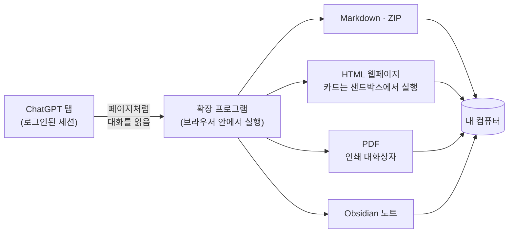

  

<h1 align="center">Chat &amp; Intelligent UI Exporter for ChatGPT</h1>

  ChatGPT 대화를 조작할 수 있는 <b>Intelligent UI</b> 카드까지 함께 
  Markdown, HTML, PDF로 저장하거나 Obsidian에 바로 저장합니다. 모든 처리는 내 컴퓨터에서 이루어집니다.

  
  
  
  
  

  <a href="../../README.md">English</a> ·
  <a href="README.zh-CN.md">简体中文</a> ·
  <a href="README.zh-TW.md">繁體中文</a> ·
  <a href="README.ja.md">日本語</a> ·
  <b>한국어</b> ·
  <a href="README.es.md">Español</a> ·
  <a href="README.pt-BR.md">Português</a> ·
  <a href="README.fr.md">Français</a> ·
  <a href="README.de.md">Deutsch</a> ·
  <a href="README.ru.md">Русский</a>

  <a href="#설치">설치</a> ·
  <a href="#내보낼-수-있는-것">내보낼 수 있는 것</a> ·
  <a href="#빠른-시작">빠른 시작</a> ·
  <a href="#자주-묻는-질문">자주 묻는 질문</a> ·
  <a href="../../PRIVACY.md">개인정보</a> ·
  <a href="#의견-보내기">의견 보내기</a>

  

> 스크린샷은 영어 화면입니다. 확장 프로그램은 브라우저 언어를 따릅니다.

## 만든 이유

ChatGPT의 답변은 이제 글자만이 아닙니다. 표, 수식, 생성된 이미지, 코드 인터프리터가 만든 파일, 그리고 탭과 슬라이더, 버튼이 있는 **인터랙티브 카드**(Intelligent UI)가 점점 늘고 있습니다. 복사해 붙여 넣으면 대부분이 사라지고, ChatGPT 자체 데이터 내보내기는 원시 JSON일 뿐입니다.

이 확장 프로그램은 ChatGPT 페이지처럼 대화를 읽어 빠짐없이 저장합니다.

- **잃는 것이 없습니다.** 본문은 편집할 수 있는 그대로, 원본 이미지와 파일은 내려받습니다. 카드는 이미지와 텍스트로 함께 남아 검색도 됩니다.
- **카드가 그대로 동작합니다.** HTML 내보내기에서는 카드가 다시 실행됩니다. 탭을 바꾸고 슬라이더를 움직이면 숫자가 바뀝니다.
- **처음부터 개인정보 보호.** 서버 없음, 계정 없음, 분석 없음, AI 호출 없음. 자세한 내용은 [PRIVACY.md](../../PRIVACY.md)(영어·중국어).

## 내보낼 수 있는 것

| 형식 | 파일 | 알맞은 용도 |
| --- | --- | --- |
| **텍스트만** | `.md` | 노트 앱, 빠른 복사. 표, 코드, 수식, 출처 링크가 있는 Markdown. |
| **전체 아카이브** | `.zip` | 모두 보관: Markdown에 원본 이미지, 카드 이미지, 첨부 및 생성 파일까지. |
| **HTML 웹페이지** | `.html`(또는 `.html.zip`) | 읽기와 공유. ChatGPT와 비슷한 모습에 카드도 조작할 수 있습니다. |
| **PDF(인쇄)** | 인쇄 대화상자로 | 인쇄와 제출. 선택하고 검색할 수 있는 진짜 텍스트, A4 레이아웃. |
| **Obsidian** | 보관함의 노트 하나 | 고른 폴더에 저장하고 노트를 엽니다. |

대화 전체나 체크한 메시지만 내보낼 수 있고, 저장된 대화(`/c/…`)와 공유 링크(`/share/…`) 모두 됩니다. 긴 대화도 보통 1초 정도면 끝나며, 탭이 뒤에 있어도 됩니다.

### Intelligent UI 카드를 두 가지로 보관

<table>
  <tr>
    <td width="50%" valign="top">
      <b>HTML 웹페이지: 카드가 그대로 동작</b>  
      
    </td>
    <td width="50%" valign="top">
      <b>Markdown: 이미지와 검색되는 텍스트</b>  
      
<pre lang="markdown">

&gt; [!note]- 카드 텍스트
&gt; **Kyoto trip budget** · [Estimate]
&gt; 옵션: Budget / **Comfort** / Luxury
&gt; | Item  | Per day | Total |
&gt; | Hotel | \$160   | \$480 |
&gt; …</pre>
    </td>
  </tr>
</table>

다른 상태에서만 보이는 텍스트(다른 탭, 펼친 섹션)는 "카드의 다른 상태 내용"에 모아 두므로 클릭 뒤에 숨지 않습니다. 형식별 자세한 내용은 [docs/export-formats.md](../export-formats.md)(영어)를 보세요.

## 설치

> [!NOTE]
> Chrome 웹 스토어 등록을 준비 중입니다. 그전까지는 이 저장소에서 불러오세요.

1. 이 저장소를 내려받아([**Code → Download ZIP**](https://github.com/letheli710/chat-intelligent-ui-exporter/archive/refs/heads/main.zip)) 압축을 풀거나 `git clone` 합니다.
2. `chrome://extensions`를 열고 오른쪽 위의 **개발자 모드**를 켭니다.
3. **압축해제된 확장 프로그램을 로드합니다**를 누르고 `extension` 폴더를 고릅니다.
4. [chatgpt.com](https://chatgpt.com)에서 대화를 열면 입력창 옆에 버튼 두 개가 나타납니다.

Chrome용입니다. Manifest V3를 지원하는 다른 Chromium 브라우저(Edge, Brave)에서도 동작할 것이지만 테스트하지는 않았습니다.

## 빠른 시작

1. **ChatGPT 대화를 엽니다.**
2. **입력창 옆의 내보내기 버튼**이나 도구 모음의 확장 프로그램 아이콘을 누릅니다.
3. 옆 메뉴에서 **형식을 고릅니다**. 고른 형식은 기억됩니다.
4. 일부만 내보내려면 **사이드바**를 열고(목록 버튼 또는 <kbd>Alt</kbd>+<kbd>Shift</kbd>+<kbd>E</kbd>) 메시지를 체크한 뒤 **내보내기**를 누릅니다.

파일은 "다운로드" 폴더에 저장됩니다(매번 위치를 고를 수도 있습니다. "설정" 참고). Obsidian은 처음에 노트 폴더를 한 번 고르면, 그다음부터 **저장**으로 노트를 쓰고 **열기**로 바로 이동합니다.

 

  

## 동작 방식

- 확장 프로그램은 브라우저가 이미 가진 로그인 상태로 ChatGPT 사이트에서 대화를 읽습니다. 페이지를 스크롤하거나 화면을 캡처하지 않습니다.
- 카드는 확장 프로그램 안의 격리된 샌드박스 페이지에서 카드 프로그램을 실행해 그리므로, ChatGPT에서 보이는 것과 같습니다.
- 우리 서버로 보내는 일은 없습니다. 서버가 아예 없습니다.

## 설정

사이드바의 톱니바퀴, 도구 모음 패널, 확장 프로그램의 옵션 페이지에서 엽니다. 항목 옆 ⓘ에 설명이 있고, 일부는 예시가 있는 설명 페이지를 엽니다.

<b>설정 페이지 보기</b>

 

| 설정 | 바뀌는 것 |
| --- | --- |
| **용도**: 범용 / Obsidian | 범용은 ChatGPT가 답변에 쓴 HTML을 텍스트로 보여 주어 어느 앱에서나 같게 보입니다. Obsidian은 그 효과(접기, 작은 이미지)를 유지합니다. |
| **HTML 웹페이지 형식** | 파일 하나(기본, 보내기 쉬움) 또는 폴더가 든 ZIP(페이지가 작고 이미지가 많을 때 알맞음). [자세히](../export-formats.md#html-page) |
| **파일 이름 형식** | 제목, 제목과 날짜, 날짜와 제목, 또는 나만의 접두어. |
| **Markdown 내용** | Obsidian 속성(제목, 출처, 시간, 모델), 메시지 시간, 역할 이름. |
| **이미지 카드를 HTML로**(Beta) | 이미지·텍스트 목록 카드를 표 대신 나란히 놓인 HTML로 씁니다. |
| **내보낼 때마다 저장 위치 선택** | "다운로드" 대신 매번 저장 위치를 묻습니다. |
| **언어** | 브라우저를 따르거나 10개 언어 중에서 고릅니다. |

## 개인정보와 권한

이 확장 프로그램은 대화를 어디에도 보내지 않습니다. 전체 정책은 [PRIVACY.md](../../PRIVACY.md)에 있습니다. 요약하면:

| 권한 | 필요한 이유 |
| --- | --- |
| `chatgpt.com`, `chat.openai.com` | 버튼을 표시하고 보고 있는 대화를 읽기 위해. |
| `images.openai.com` | 검색 결과 이미지를 쿠키 없이 내려받기 위해. |
| `scripting` | 확장 프로그램을 설치하거나 업데이트할 때 이미 열린 ChatGPT 탭에 패널을 넣기 위해. |
| `downloads` | 내보낸 파일을 저장하기 위해. |
| `storage` | 설정을 내 컴퓨터에만 기억하기 위해. |

> [!TIP]
> 내보낸 HTML 페이지는 일반 웹페이지와 같습니다. 대화 자체가 웹의 이미지나 앱을 가리키면, 파일을 열 때 브라우저가 불러옵니다. 지도는 "끌어 볼 수 있는 지도를 온라인으로 열기"를 누르기 전에는 오프라인입니다.

## 자주 묻는 질문

<b>단축키가 동작하지 않거나, 사이드바 대신 도구 모음 패널이 열립니다.</b>

Chrome은 처음 설치할 때만 추천 키 <kbd>Alt</kbd>+<kbd>Shift</kbd>+<kbd>E</kbd>를 지정하며, 다른 확장 프로그램이 이미 그 키를 쓰면 지정하지 않습니다. `chrome://extensions/shortcuts`를 열고 "내보내기 사이드바 열기 / 닫기" 행에 키를 지정하세요. Chrome 기본 제공인 다른 행은 도구 모음 패널을 엽니다. 지금 지정된 키는 확장 프로그램 설정에 표시됩니다.

<b>파일 하나와 ZIP 중 무엇을 고를까요?</b>

둘 다 모양과 동작이 같습니다. 파일 하나는 보내기 쉽지만 안의 이미지보다 약 3분의 1 커집니다. 이미지가 많으면 ZIP이 더 빨리 열리고 원본도 꺼낼 수 있습니다. 이미지와 첨부 파일이 10개를 넘으면 확장 프로그램이 ZIP을 권하며, 한 번 클릭으로 바꿀 수 있습니다.

<b>HTML 페이지 일부가 "Removed" 상자로 바뀌어 있습니다.</b>

ChatGPT가 답변에 쓴 HTML을 유지할 때, 코드를 실행할 수 있는 부분(삽입된 페이지, 플레이어, 양식, 스크립트 링크)은 파일에 넣기 전에 제거됩니다. 상자에 무엇을 제거했는지 적혀 있고, 이유를 설명한 [docs/html-filter.md](../html-filter.md)(영어)로 연결됩니다.

<b>다시 생성한 다른 답변도 내보내나요?</b>

아직은 아닙니다. 페이지에 보이는 답변만 내보냅니다. ChatGPT는 클릭한 상태를 저장하지 않으므로 카드는 기본 상태로 내보내고, 다른 상태는 텍스트로 적습니다.

<b>Markdown 앱에서 이미지가 보이지 않습니다.</b>

`conversation.md`와 `assets/` 폴더를 같은 곳에 두세요. 이미지는 상대 경로로 연결됩니다. 이미지가 필요하면 **전체 아카이브(.zip)**를 쓰세요. **텍스트만**은 Markdown만 씁니다.

<b>공유 링크나 무료 요금제에서도 되나요?</b>

됩니다. 저장된 대화와 공유 링크 모두, 어떤 요금제에서도 됩니다. 내 대화는 로그인이 필요하고, 공유 링크는 ChatGPT가 보여 주는 한 로그인 없이도 됩니다.

<b>OpenAI나 개발자에게 무언가 보내지나요?</b>

확장 프로그램은 내보내려는 대화를 읽기 위해 ChatGPT 사이트와만 통신하며, 이는 페이지 자체가 하는 일과 같습니다. 개발자에게는 아무것도 보내지 않습니다. "문제 신고" 링크는 Google 설문지를 열 뿐이고, 제출하지 않으면 아무것도 보내지지 않습니다.

## 문서

- [내보내기 형식 자세히](../export-formats.md)(영어): 형식별 내용, ZIP 구조, 카드·지도·삽입 앱·PDF 페이지 처리 방식.
- [HTML 내보내기에서 제거되는 것과 그 이유](../html-filter.md)(영어)
- [개인정보처리방침](../../PRIVACY.md)(영어·중국어)
- [개발 가이드](../DEVELOPMENT.md)(영어): 빌드, 테스트와 검사, 위 스크린샷을 만드는 방법.
- [제3자 고지](../../extension/THIRD_PARTY_NOTICES.md)

## 의견 보내기

- 문제가 있거나 개선 아이디어가 있나요? 도구 모음 패널 아래쪽의 **문제 신고**를 누르면, 버전과 브라우저가 채워진 [짧은 설문지](https://docs.google.com/forms/d/e/1FAIpQLSemj8AaDckqB2NJ_tsb3VW2jG1AxM-NIrmKJMom8IXtjUYgaQ/viewform)가 열립니다.
- GitHub가 편하다면 [이슈를 등록](https://github.com/letheli710/chat-intelligent-ui-exporter/issues)하세요. 실제 대화, HAR 파일, 쿠키는 첨부하지 마세요.
- Pull Request를 환영합니다. 먼저 [개발 가이드](../DEVELOPMENT.md)를 보세요.

## 감사의 말

[marked](https://github.com/markedjs/marked)(Markdown → HTML), [JSZip](https://stuk.github.io/jszip/)(압축), [Lucide](https://lucide.dev)(카드 아이콘)를 사용합니다. 코드 블록 펜스 길이와 KaTeX 주석 추출은 [otaliptus/chatgpt-markdown-exporter](https://github.com/otaliptus/chatgpt-markdown-exporter)의 방식을 참고했습니다. 라이선스는 [extension/licenses](../../extension/licenses)에 있습니다.

## 라이선스

[MIT](../../LICENSE). 이 프로젝트는 OpenAI와 관련이 없으며, OpenAI의 승인이나 후원을 받지 않았습니다. ChatGPT는 OpenAI의 상표입니다.
