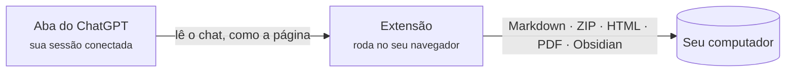

  

<h1 align="center">Chat &amp; Intelligent UI Exporter for ChatGPT</h1>

  Salve conversas do ChatGPT, com os cards interativos de <b>Intelligent UI</b>, 
  como Markdown, HTML, PDF ou direto no Obsidian. Tudo acontece no seu computador.

  
  
  
  
  

  <a href="../../README.md">English</a> ·
  <a href="README.zh-CN.md">简体中文</a> ·
  <a href="README.zh-TW.md">繁體中文</a> ·
  <a href="README.ja.md">日本語</a> ·
  <a href="README.ko.md">한국어</a> ·
  <a href="README.es.md">Español</a> ·
  <b>Português</b> ·
  <a href="README.fr.md">Français</a> ·
  <a href="README.de.md">Deutsch</a> ·
  <a href="README.ru.md">Русский</a>

  <a href="#instalação">Instalação</a> ·
  <a href="#o-que-você-recebe">O que você recebe</a> ·
  <a href="#primeiros-passos">Primeiros passos</a> ·
  <a href="#perguntas-frequentes">Perguntas frequentes</a> ·
  <a href="../../PRIVACY.md">Privacidade</a> ·
  <a href="#feedback">Feedback</a>

  

> As capturas mostram a interface em inglês; a extensão segue o idioma do seu navegador.

## Por que existe

As respostas do ChatGPT já não são só texto. Elas têm tabelas, fórmulas, imagens geradas, arquivos do interpretador de código e, cada vez mais, **cards interativos** (Intelligent UI) com abas, controles deslizantes e botões. Copiar e colar perde quase tudo isso, e a exportação de dados do próprio ChatGPT entrega JSON bruto.

Esta extensão lê a conversa do mesmo jeito que a página do ChatGPT e grava tudo:

- **Nada se perde.** O texto continua editável, imagens e arquivos originais são baixados, e cada card é guardado como imagem *e* como texto, então dá para pesquisar.
- **Os cards continuam funcionando.** Na exportação HTML eles rodam de novo: troque de aba, mova o controle deslizante e veja os números mudarem.
- **Privada desde a concepção.** Sem servidor, sem conta, sem análises, sem chamadas a IA. Veja [PRIVACY.md](../../PRIVACY.md) (em inglês e chinês).

## O que você recebe

| Formato | Arquivo | Melhor para |
| --- | --- | --- |
| **Só texto** | `.md` | Apps de notas e cópias rápidas. Markdown com tabelas, código, fórmulas e links de fontes. |
| **Arquivo completo** | `.zip` | Guardar tudo: Markdown mais imagens originais, imagens dos cards e arquivos anexados ou gerados. |
| **Página HTML** | `.html` (ou `.html.zip`) | Ler e compartilhar. Parece o ChatGPT, e os cards são interativos. |
| **PDF (imprimir)** | pela caixa de impressão | Imprimir e entregar. Texto de verdade, que dá para selecionar e pesquisar, em A4. |
| **Obsidian** | uma nota no seu cofre | Salva na pasta que você escolher e abre a nota. |

Você pode exportar a conversa inteira ou só as mensagens marcadas, de chats salvos (`/c/…`) e de links compartilhados (`/share/…`). Conversas longas costumam levar cerca de um segundo, mesmo com a aba em segundo plano.

### Cards de Intelligent UI, guardados de dois jeitos

<table>
  <tr>
    <td width="50%" valign="top">
      <b>Página HTML: o card continua funcionando</b>  
      
    </td>
    <td width="50%" valign="top">
      <b>Markdown: uma imagem e texto pesquisável</b>  
      
<pre lang="markdown">

&gt; [!note]- Texto do card
&gt; **Kyoto trip budget** · [Estimate]
&gt; Opções: Budget / **Comfort** / Luxury
&gt; | Item  | Per day | Total |
&gt; | Hotel | \$160   | \$480 |
&gt; …</pre>
    </td>
  </tr>
</table>

O texto que um card só mostra em outro estado (outra aba, uma seção aberta) aparece em *Conteúdo do cartão em outros estados*, então nada fica escondido atrás de um clique. Os detalhes de cada formato estão em [docs/export-formats.md](../export-formats.md) (em inglês).

## Instalação

> [!NOTE]
> A página na Chrome Web Store está a caminho. Até lá, carregue a extensão a partir deste repositório.

1. Baixe este repositório ([**Code → Download ZIP**](https://github.com/letheli710/chat-intelligent-ui-exporter/archive/refs/heads/main.zip)) e descompacte, ou use `git clone`.
2. Abra `chrome://extensions` e ative o **Modo do desenvolvedor** (canto superior direito).
3. Clique em **Carregar sem compactação** e escolha a pasta `extension`.
4. Abra uma conversa em [chatgpt.com](https://chatgpt.com). Dois botões aparecem ao lado da caixa de texto.

Feita para o Chrome. Outros navegadores Chromium com Manifest V3 (Edge, Brave) devem funcionar, mas não foram testados.

## Primeiros passos

1. **Abra uma conversa do ChatGPT.**
2. **Clique no botão de exportar** ao lado da caixa de texto, ou no ícone da extensão na barra de ferramentas.
3. **Escolha um formato** no menu ao lado. A escolha fica salva.
4. Quer só uma parte? Abra a **barra lateral** (o botão de lista, ou <kbd>Alt</kbd>+<kbd>Shift</kbd>+<kbd>E</kbd>), marque as mensagens e clique em **Exportar**.

O arquivo vai para a pasta Downloads (ou onde você escolher; veja *Ajustes*). Para o Obsidian, você escolhe a pasta de notas uma vez; depois, **Salvar** grava a nota e **Abrir** vai até ela.

 

  

## Como funciona

- A extensão pede a conversa ao próprio site do ChatGPT, com o login que seu navegador já tem. Ela não rola a página nem tira capturas dela.
- Os cards são desenhados rodando o programa do card numa página isolada (sandbox) dentro da extensão, então a imagem bate com o que o ChatGPT mostra.
- Nada vai para um servidor nosso, porque não existe nenhum.

## Ajustes

Abra pela engrenagem da barra lateral, pelo painel da barra de ferramentas ou pela página de opções da extensão. O ⓘ ao lado de cada ajuste explica o que ele faz; alguns abrem uma página com exemplos.

<b>Ver a página de ajustes</b>

 

| Ajuste | O que muda |
| --- | --- |
| **Feito para**: Genérico / Obsidian | Genérico mostra como texto o HTML que o ChatGPT escreve dentro de uma resposta, para ficar igual em qualquer app; Obsidian deixa ele funcionando (blocos recolhíveis, imagens pequenas). |
| **Formato da página HTML** | Um arquivo (padrão, fácil de enviar) ou um ZIP com pastas (página menor, melhor com muitas imagens). [Mais](../export-formats.md#html-page) |
| **Formato do nome** | Título, título e data, data e título, ou um prefixo seu. |
| **Conteúdo do Markdown** | Propriedades do Obsidian (título, fonte, horário, modelo), horário das mensagens, nomes dos papéis. |
| **Cartões com imagens como HTML** (Beta) | Escreve os cards de lista com imagem e texto como HTML lado a lado, em vez de tabela. |
| **Escolher onde salvar a cada exportação** | Pergunta a pasta a cada exportação em vez de usar Downloads. |
| **Idioma** | Segue o navegador, ou escolha um de 10 idiomas. |

## Privacidade e permissões

A extensão nunca envia suas conversas para lugar nenhum. A política completa está em [PRIVACY.md](../../PRIVACY.md); em resumo:

| Permissão | Por que é necessária |
| --- | --- |
| `chatgpt.com`, `chat.openai.com` | Mostrar os botões e ler a conversa que você está vendo. |
| `images.openai.com` | Baixar as imagens dos resultados de pesquisa, sem cookies. |
| `scripting` | Colocar o painel nas abas do ChatGPT que já estavam abertas quando a extensão foi instalada ou atualizada. |
| `downloads` | Salvar o arquivo exportado. |
| `storage` | Lembrar seus ajustes, só no seu computador. |

> [!TIP]
> Uma página HTML exportada se comporta como qualquer página da web: se o próprio chat aponta para imagens ou apps na web, o navegador carrega tudo ao abrir o arquivo. O mapa fica off-line, a menos que você clique em *Abrir o mapa interativo on-line*.

## Perguntas frequentes

<b>O atalho de teclado não faz nada, ou abre o painel da barra de ferramentas em vez da barra lateral.</b>

O Chrome só atribui o atalho sugerido <kbd>Alt</kbd>+<kbd>Shift</kbd>+<kbd>E</kbd> na primeira instalação da extensão, e não o faz se outra extensão já usa essas teclas. Abra `chrome://extensions/shortcuts` e defina a linha **Abrir / fechar a barra lateral de exportação**. A outra linha, a do próprio Chrome, abre o painel da barra de ferramentas. Os ajustes da extensão mostram qual tecla está definida agora.

<b>Um arquivo HTML ou ZIP?</b>

Os dois ficam e funcionam iguais. Um arquivo é o mais fácil de enviar, mas fica cerca de um terço maior que as imagens dentro dele. Com muitas imagens, o ZIP abre mais rápido e deixa você tirar os originais. Quando um chat tem mais de 10 imagens e arquivos, a extensão sugere o ZIP, a um clique.

<b>Algumas partes de uma resposta viraram um quadro "Removed" na página HTML.</b>

Quando o HTML escrito pelo ChatGPT é mantido, tudo o que poderia rodar código (páginas incorporadas, players, formulários, links de script) é removido antes de entrar no seu arquivo. O quadro diz o que foi removido e leva a [docs/html-filter.md](../html-filter.md) (em inglês), que explica cada caso.

<b>Ele exporta as outras respostas que eu regenerei?</b>

Ainda não: só a resposta mostrada na página. Os cards são exportados no estado padrão, porque o ChatGPT não guarda o que você clicou; os outros estados aparecem como texto.

<b>As imagens não aparecem no meu app de Markdown.</b>

Deixe `conversation.md` ao lado da pasta `assets/`; as imagens usam caminhos relativos. Use **Arquivo completo (.zip)** para ter as imagens; **Só texto** grava só o Markdown.

<b>Funciona com links compartilhados e no plano gratuito?</b>

Sim. Chats salvos e links compartilhados, em qualquer plano. Para os seus próprios chats é preciso estar conectado; links compartilhados funcionam sem login enquanto o ChatGPT os mostrar.

<b>Algo é enviado para a OpenAI ou para você?</b>

A extensão só fala com o site do ChatGPT para ler a conversa que você pediu para exportar, como a própria página faz. Nada é enviado ao desenvolvedor. O link *Relatar um problema* abre um formulário do Google, e nada é enviado se você não enviar.

## Documentação

- [Formatos de exportação em detalhe](../export-formats.md) (em inglês): o que cada formato contém, a estrutura do ZIP, como cards, mapas, apps incorporados e páginas PDF são tratados.
- [O que a exportação HTML remove, e por quê](../html-filter.md) (em inglês)
- [Política de privacidade](../../PRIVACY.md) (em inglês e chinês)
- [Guia de desenvolvimento](../DEVELOPMENT.md) (em inglês): build, testes e verificações, como as capturas acima são feitas.
- [Avisos de terceiros](../../extension/THIRD_PARTY_NOTICES.md)

## Feedback

- Algo quebrou ou poderia ser melhor? Use **Relatar um problema** no rodapé do painel da barra de ferramentas. Ele abre um [formulário curto](https://docs.google.com/forms/d/e/1FAIpQLSemj8AaDckqB2NJ_tsb3VW2jG1AxM-NIrmKJMom8IXtjUYgaQ/viewform) com sua versão e navegador já preenchidos.
- Prefere o GitHub? [Abra uma issue](https://github.com/letheli710/chat-intelligent-ui-exporter/issues). Por favor, não anexe conversas reais, arquivos HAR nem cookies.
- Pull requests são bem-vindos; comece pelo [guia de desenvolvimento](../DEVELOPMENT.md).

## Agradecimentos

Feita com [marked](https://github.com/markedjs/marked) (Markdown para HTML), [JSZip](https://stuk.github.io/jszip/) (arquivos compactados) e [Lucide](https://lucide.dev) (ícones dos cards). O tamanho das cercas de código e a extração de anotações KaTeX foram adaptados de [otaliptus/chatgpt-markdown-exporter](https://github.com/otaliptus/chatgpt-markdown-exporter). As licenças estão em [extension/licenses](../../extension/licenses).

## Licença

[MIT](../../LICENSE). Este projeto não é afiliado, endossado nem patrocinado pela OpenAI. ChatGPT é uma marca da OpenAI.
