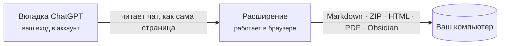

  

<h1 align="center">Chat &amp; Intelligent UI Exporter for ChatGPT</h1>

  Сохраняйте разговоры с ChatGPT вместе с интерактивными карточками <b>Intelligent UI</b> 
  в Markdown, HTML, PDF или сразу в Obsidian. Всё происходит на вашем компьютере.

  
  
  
  
  

  <a href="../../README.md">English</a> ·
  <a href="README.zh-CN.md">简体中文</a> ·
  <a href="README.zh-TW.md">繁體中文</a> ·
  <a href="README.ja.md">日本語</a> ·
  <a href="README.ko.md">한국어</a> ·
  <a href="README.es.md">Español</a> ·
  <a href="README.pt-BR.md">Português</a> ·
  <a href="README.fr.md">Français</a> ·
  <a href="README.de.md">Deutsch</a> ·
  <b>Русский</b>

  <a href="#установка">Установка</a> ·
  <a href="#что-вы-получаете">Что вы получаете</a> ·
  <a href="#быстрый-старт">Быстрый старт</a> ·
  <a href="#частые-вопросы">Частые вопросы</a> ·
  <a href="../../PRIVACY.md">Конфиденциальность</a> ·
  <a href="#обратная-связь">Обратная связь</a>

  

> На снимках интерфейс на английском; расширение следует языку вашего браузера.

## Зачем это нужно

Ответы ChatGPT давно не только текст. В них таблицы, формулы, сгенерированные изображения, файлы из интерпретатора кода и всё чаще **интерактивные карточки** (Intelligent UI) с вкладками, ползунками и кнопками. Копирование теряет почти всё это, а штатный экспорт данных ChatGPT выдаёт сырой JSON.

Это расширение читает разговор так же, как страница ChatGPT, и сохраняет его целиком:

- **Ничего не теряется.** Текст остаётся редактируемым, исходные изображения и файлы скачиваются, а каждая карточка сохраняется и как изображение, *и* как текст, поэтому по ней работает поиск.
- **Карточки продолжают работать.** В HTML-экспорте они запускаются снова: переключайте вкладки, двигайте ползунок — числа меняются.
- **Конфиденциально по замыслу.** Нет сервера, учётной записи, аналитики и обращений к ИИ. См. [PRIVACY.md](../../PRIVACY.md) (на английском и китайском).

## Что вы получаете

| Формат | Файл | Подходит для |
| --- | --- | --- |
| **Markdown, только текст** | `.md` | Приложений для заметок и быстрых копий. Markdown с таблицами, кодом, формулами и ссылками на источники. |
| **Пакет Markdown** | `.zip` | Сохранить всё: Markdown плюс исходные изображения, изображения карточек, прикреплённые и созданные файлы. |
| **HTML-страница** | `.html` (или `.html.zip`) | Чтения и пересылки. Похожа на ChatGPT, карточки интерактивны. |
| **PDF (печать)** | через диалог печати | Печати и сдачи работ. Настоящий текст, который можно выделять и искать, формат A4. |
| **Obsidian** | заметка в вашем хранилище | Сохраняет в выбранную папку и открывает заметку. |

Можно экспортировать весь разговор или только отмеченные сообщения — из сохранённых чатов (`/c/…`) и из общих ссылок (`/share/…`). Длинные разговоры обычно занимают около секунды, даже если вкладка в фоне.

### Карточки Intelligent UI, сохранённые двумя способами

<table>
  <tr>
    <td width="50%" valign="top">
      <b>HTML-страница: карточка по-прежнему работает</b>  
      
    </td>
    <td width="50%" valign="top">
      <b>Markdown: изображение и текст для поиска</b>  
      
<pre lang="markdown">

&gt; [!note]- Текст карточки
&gt; **Kyoto trip budget** · [Estimate]
&gt; Варианты: Budget / **Comfort** / Luxury
&gt; | Item  | Per day | Total |
&gt; | Hotel | \$160   | \$480 |
&gt; …</pre>
    </td>
  </tr>
</table>

Текст, который карточка показывает только в другом состоянии (другая вкладка, раскрытый раздел), собран в разделе *Содержимое карточки в других состояниях*, так что ничего не прячется за щелчком. Подробности о каждом формате — в [docs/export-formats.md](../export-formats.md) (на английском).

## Установка

> [!NOTE]
> Страница в Chrome Web Store скоро появится. А пока загрузите расширение из этого репозитория.

1. Скачайте репозиторий ([**Code → Download ZIP**](https://github.com/letheli710/chat-intelligent-ui-exporter/archive/refs/heads/main.zip)) и распакуйте его или выполните `git clone`.
2. Откройте `chrome://extensions` и включите **Режим разработчика** (справа вверху).
3. Нажмите **Загрузить распакованное расширение** и выберите папку `extension`.
4. Откройте разговор на [chatgpt.com](https://chatgpt.com). Рядом с полем ввода появятся две кнопки.

Сделано для Chrome. Другие браузеры на Chromium с Manifest V3 (Edge, Brave) должны работать, но не проверялись.

## Быстрый старт

1. **Откройте разговор в ChatGPT.**
2. **Нажмите кнопку экспорта** рядом с полем ввода или значок расширения на панели инструментов.
3. **Выберите формат** в соседнем меню. Выбор запоминается.
4. Нужна только часть? Откройте **боковую панель** (кнопка списка или <kbd>Alt</kbd>+<kbd>Shift</kbd>+<kbd>E</kbd>), отметьте сообщения и нажмите **Экспорт**.

Файл попадёт в папку «Загрузки» (или куда вы укажете, см. *Настройки*). Для Obsidian вы один раз выбираете папку заметок; дальше **Сохранить** записывает заметку, а **Открыть** переходит к ней.

 

  

## Как это работает

- Расширение запрашивает разговор у самого сайта ChatGPT, используя вход, который уже есть в браузере. Оно не прокручивает страницу и не делает её снимков.
- Карточки рисуются запуском их программы на изолированной странице-песочнице внутри расширения, поэтому изображение совпадает с тем, что показывает ChatGPT.
- Ничего не уходит на наш сервер, потому что его нет.

## Настройки

Откройте их через шестерёнку на боковой панели, окно на панели инструментов или страницу параметров расширения. Значок ⓘ рядом с настройкой объясняет её; некоторые открывают страницу с примерами.

<b>Посмотреть страницу настроек</b>

 

| Настройка | Что меняет |
| --- | --- |
| **Для чего**: Обычный / Obsidian | «Обычный» показывает HTML, который ChatGPT пишет в ответе, как текст — везде одинаково; Obsidian сохраняет его действие (сворачиваемые блоки, маленькие изображения). |
| **Вид HTML-страницы** | Один файл (по умолчанию, удобно пересылать) или ZIP с папками (страница легче, лучше при множестве изображений). [Подробнее](../export-formats.md#html-page) |
| **Формат имени файла** | Заголовок, заголовок и дата, дата и заголовок или свой префикс. |
| **Содержимое Markdown** | Свойства Obsidian (заголовок, источник, время, модель), время сообщений, имена ролей. |
| **Карточки с картинками в HTML** (Beta) | Записывает карточки-списки «картинка + текст» как HTML бок о бок вместо таблицы. |
| **Выбирать место при каждом экспорте** | Спрашивает папку при каждом экспорте вместо «Загрузок». |
| **Язык** | Как в браузере или один из 10 языков. |

## Конфиденциальность и разрешения

Расширение никуда не отправляет ваши разговоры. Полная политика — в [PRIVACY.md](../../PRIVACY.md); кратко:

| Разрешение | Зачем |
| --- | --- |
| `chatgpt.com`, `chat.openai.com` | Показать кнопки и прочитать разговор, который вы смотрите. |
| `images.openai.com` | Скачать изображения из результатов поиска, без cookie. |
| `scripting` | Добавить панель во вкладки ChatGPT, уже открытые при установке или обновлении расширения. |
| `downloads` | Сохранить экспортированный файл. |
| `storage` | Запомнить настройки, только на вашем компьютере. |

> [!TIP]
> Экспортированная HTML-страница ведёт себя как любая веб-страница: если сам чат ссылается на изображения или приложения в сети, браузер загрузит их при открытии файла. Карта остаётся офлайн, пока вы не нажмёте *Открыть интерактивную карту в сети*.

## Частые вопросы

<b>Сочетание клавиш ничего не делает или открывает окно на панели инструментов вместо боковой панели.</b>

Chrome назначает предложенное <kbd>Alt</kbd>+<kbd>Shift</kbd>+<kbd>E</kbd> только при первой установке и не назначает, если эти клавиши уже заняты другим расширением. Откройте `chrome://extensions/shortcuts` и задайте строку **Открыть / закрыть боковую панель экспорта**. Другая строка, встроенная в Chrome, открывает окно на панели инструментов. В настройках расширения видно, какая клавиша назначена сейчас.

<b>Один HTML-файл или ZIP?</b>

Оба выглядят и работают одинаково. Один файл проще переслать, но он примерно на треть больше, чем изображения в нём. При множестве изображений ZIP открывается быстрее и позволяет достать оригиналы. Когда в чате больше 10 изображений и файлов, расширение предложит ZIP — в один щелчок.

<b>Части ответа на HTML-странице заменены рамкой «Removed».</b>

Когда HTML, написанный ChatGPT, сохраняется, всё, что могло бы выполнять код (встроенные страницы, плееры, формы, ссылки-скрипты), удаляется до попадания в файл. Рамка говорит, что удалено, и ведёт на [docs/html-filter.md](../html-filter.md) (на английском), где объяснён каждый случай.

<b>Экспортируются ли другие ответы, которые я перегенерировал?</b>

Пока нет: только ответ, показанный на странице. Карточки экспортируются в состоянии по умолчанию, потому что ChatGPT не сохраняет, что вы нажимали; другие состояния перечислены текстом.

<b>В моём приложении для Markdown нет изображений.</b>

Держите `conversation.md` рядом с папкой `assets/`: изображения подключены относительными путями. Чтобы получить изображения, выберите **Пакет Markdown (.zip)**; **Markdown, только текст** записывает лишь Markdown.

<b>Работает ли это с общими ссылками и на бесплатном тарифе?</b>

Да. Сохранённые чаты и общие ссылки, на любом тарифе. Для своих чатов нужно войти в аккаунт; общие ссылки работают и без входа, пока ChatGPT их показывает.

<b>Отправляется ли что-нибудь в OpenAI или вам?</b>

Расширение обращается только к сайту ChatGPT, чтобы прочитать разговор, который вы попросили экспортировать, — так же, как сама страница. Разработчику ничего не отправляется. Ссылка *Сообщить о проблеме* открывает форму Google, и ничего не уйдёт, пока вы её не отправите.

## Документация

- [Форматы экспорта подробно](../export-formats.md) (на английском): что содержит каждый формат, устройство ZIP, обработка карточек, карт, встроенных приложений и страниц PDF.
- [Что удаляет HTML-экспорт и почему](../html-filter.md) (на английском)
- [Политика конфиденциальности](../../PRIVACY.md) (на английском и китайском)
- [Руководство разработчика](../DEVELOPMENT.md) (на английском): сборка, тесты и проверки, как сделаны снимки выше.
- [Уведомления о сторонних компонентах](../../extension/THIRD_PARTY_NOTICES.md)

## Обратная связь

- Что-то сломалось или может быть лучше? Нажмите **Сообщить о проблеме** внизу окна на панели инструментов. Откроется [короткая форма](https://docs.google.com/forms/d/e/1FAIpQLSemj8AaDckqB2NJ_tsb3VW2jG1AxM-NIrmKJMom8IXtjUYgaQ/viewform), где уже указаны версия и браузер.
- Удобнее GitHub? [Создайте issue](https://github.com/letheli710/chat-intelligent-ui-exporter/issues). Пожалуйста, не прикладывайте настоящие разговоры, HAR-файлы или cookie.
- Pull request приветствуются; начните с [руководства разработчика](../DEVELOPMENT.md).

## Благодарности

Использованы [marked](https://github.com/markedjs/marked) (Markdown в HTML), [JSZip](https://stuk.github.io/jszip/) (архивы) и [Lucide](https://lucide.dev) (значки карточек). Подбор длины ограждений кода и извлечение аннотаций KaTeX основаны на подходе [otaliptus/chatgpt-markdown-exporter](https://github.com/otaliptus/chatgpt-markdown-exporter). Лицензии лежат в [extension/licenses](../../extension/licenses).

## Лицензия

[MIT](../../LICENSE). Проект не связан с OpenAI и не одобрен и не спонсируется OpenAI. ChatGPT — товарный знак OpenAI.
