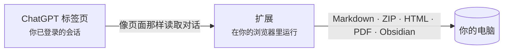

  

<h1 align="center">Chat &amp; Intelligent UI Exporter for ChatGPT</h1>

  把 ChatGPT 对话连同其中可交互的 <b>Intelligent UI</b> 卡片， 
  保存为 Markdown、HTML、PDF，或直接存进 Obsidian。全程在你的电脑上完成。

  
  
  
  
  

  <a href="../../README.md">English</a> ·
  <b>简体中文</b> ·
  <a href="README.zh-TW.md">繁體中文</a> ·
  <a href="README.ja.md">日本語</a> ·
  <a href="README.ko.md">한국어</a> ·
  <a href="README.es.md">Español</a> ·
  <a href="README.pt-BR.md">Português</a> ·
  <a href="README.fr.md">Français</a> ·
  <a href="README.de.md">Deutsch</a> ·
  <a href="README.ru.md">Русский</a>

  <a href="#安装">安装</a> ·
  <a href="#能导出什么">能导出什么</a> ·
  <a href="#快速上手">快速上手</a> ·
  <a href="#常见问题">常见问题</a> ·
  <a href="../../PRIVACY.md">隐私</a> ·
  <a href="#反馈">反馈</a>

  

> 截图里是英文界面；扩展会跟随浏览器语言，中文浏览器里显示的就是中文。

## 为什么做这个

ChatGPT 的回答早就不只是文字了：表格、公式、生成的图片、代码解释器产出的文件，还有越来越多带标签页、滑块和按钮的**交互卡片**（Intelligent UI）。复制粘贴会丢掉大半，ChatGPT 自带的数据导出给你的只是原始 JSON。

这个扩展像 ChatGPT 页面那样读取对话，再完整地写出来：

- **一点不丢。** 正文保持可编辑，原图和文件都下载下来；每张卡片既保存成图片，又保留文字，照样能搜索。
- **卡片还能用。** 在 HTML 导出里，卡片会重新运行：切标签页、拖滑块，数字跟着变。
- **从设计上就保护隐私。** 没有服务器、不用注册、没有统计、不调用 AI。详见 [PRIVACY.md](../../PRIVACY.md)。

## 能导出什么

| 格式 | 文件 | 适合 |
| --- | --- | --- |
| **仅文字** | `.md` | 笔记软件、快速复制。带表格、代码、公式和来源链接的 Markdown。 |
| **完整归档** | `.zip` | 什么都留着：Markdown 加原图、卡片图、上传的和生成的文件。 |
| **HTML 网页** | `.html`（或 `.html.zip`） | 阅读和分享。外观接近 ChatGPT，卡片可以操作。 |
| **PDF（打印）** | 通过打印对话框 | 打印、提交。文字能选中、能搜索，A4 排版。 |
| **Obsidian** | 你笔记库里的一篇笔记 | 存进你选的文件夹，并打开这篇笔记。 |

可以导出整段对话，也可以只导出勾选的消息；已保存的对话（`/c/…`）和分享链接（`/share/…`）都行。长对话通常一秒左右导完，标签页在后台也可以。

### Intelligent UI 卡片，两种方式保存

<table>
  <tr>
    <td width="50%" valign="top">
      <b>HTML 网页：卡片照样能用</b>  
      
    </td>
    <td width="50%" valign="top">
      <b>Markdown：一张图加可搜索的文字</b>  
      
<pre lang="markdown">

&gt; [!note]- 卡片文字
&gt; **Kyoto trip budget** · [Estimate]
&gt; 选项：Budget / **Comfort** / Luxury
&gt; | Item  | Per day | Total |
&gt; | Hotel | \$160   | \$480 |
&gt; …</pre>
    </td>
  </tr>
</table>

卡片只在其他状态下才显示的文字（别的标签页、展开后的折叠区），列在「卡片在其他状态下的内容」里，不会藏在一次点击后面。各格式的细节见 [docs/export-formats.md](../export-formats.md)（英文）。

## 安装

> [!NOTE]
> Chrome 应用商店版本即将上架。在那之前，请从这个仓库加载。

1. 下载本仓库（[**Code → Download ZIP**](https://github.com/letheli710/chat-intelligent-ui-exporter/archive/refs/heads/main.zip)）并解压，或用 `git clone`。
2. 打开 `chrome://extensions`，打开右上角的**开发者模式**。
3. 点**加载已解压的扩展程序**，选择 `extension` 文件夹。
4. 在 [chatgpt.com](https://chatgpt.com) 打开一段对话，输入框旁会出现两个按钮。

为 Chrome 打造。其他支持 Manifest V3 的 Chromium 浏览器（Edge、Brave）应该也能用，但没有测试过。

## 快速上手

1. **打开一段 ChatGPT 对话。**
2. **点输入框旁的导出按钮**，或工具栏上的扩展图标。
3. 在旁边的菜单里**选格式**，选过会记住。
4. 只想导出一部分？打开**侧边栏**（列表按钮，或 <kbd>Alt</kbd>+<kbd>Shift</kbd>+<kbd>E</kbd>），勾选消息，再点**导出**。

文件存到「下载」文件夹（也可以每次自己选位置，见「设置」）。存进 Obsidian 时，第一次选好笔记文件夹，之后**保存**写入笔记，**打开**直接跳过去。

 

  

## 工作原理

- 扩展用浏览器已有的登录状态，向 ChatGPT 自己的网站读取对话。不滚动页面，也不截取页面。
- 卡片是在扩展内部一个隔离的沙箱页面里运行卡片程序画出来的，所以和 ChatGPT 上看到的一样。
- 不会发到我们的服务器，因为根本没有服务器。

## 设置

从侧边栏的齿轮、工具栏面板或扩展的设置页打开。每项旁边的 ⓘ 有说明，有几项还会打开带示例的说明页。

<b>看看设置页</b>

 

| 设置 | 管什么 |
| --- | --- |
| **导出用途**：通用 / Obsidian | 通用会把 ChatGPT 写在回答里的 HTML 显示成文字，换什么软件看都一样；Obsidian 会保留它的效果（折叠块、小图）。 |
| **HTML 网页的形式** | 单文件（默认，方便发送）或带文件夹的 ZIP（网页更小，图片多时更合适）。[详情](../export-formats.md#html-page) |
| **文件名格式** | 标题、标题加日期、日期加标题，或自定义前缀。 |
| **Markdown 内容** | Obsidian 属性（标题、来源、时间、模型）、消息时间戳、角色名称。 |
| **图文卡片用 HTML**（Beta） | 把图文列表卡片写成左图右文的 HTML，而不是表格。 |
| **每次导出时选择保存位置** | 每次导出都问保存到哪里，而不是直接放进「下载」。 |
| **语言** | 跟随浏览器，或在 10 种语言里选一种。 |

## 隐私和权限

扩展从不把你的对话发到任何地方。完整政策见 [PRIVACY.md](../../PRIVACY.md)，简单说：

| 权限 | 为什么需要 |
| --- | --- |
| `chatgpt.com`、`chat.openai.com` | 显示按钮，读取你正在看的对话。 |
| `images.openai.com` | 下载搜索结果里的图片，不带 cookie。 |
| `scripting` | 安装或更新扩展时，把面板加到已经打开的 ChatGPT 标签页里。 |
| `downloads` | 保存导出的文件。 |
| `storage` | 记住你的设置，只存在你的电脑上。 |

> [!TIP]
> 导出的 HTML 页面和普通网页一样：如果对话本身引用了网上的图片或应用，打开文件时浏览器会去加载它们。地图默认不联网，除非你点「联网查看可拖动地图」。

## 常见问题

<b>快捷键没反应，或者打开的是工具栏面板而不是侧边栏。</b>

Chrome 只在第一次安装扩展时分配建议的 <kbd>Alt</kbd>+<kbd>Shift</kbd>+<kbd>E</kbd>，如果这组按键已被别的扩展占用也不会分配。打开 `chrome://extensions/shortcuts`，给「打开 / 关闭导出侧边栏」这一行设置按键；另一行是 Chrome 自带的，打开的是工具栏面板。扩展设置里会显示当前实际绑定的按键。

<b>选单文件还是 ZIP？</b>

两种打开后效果和交互完全一样。单文件最方便发送，但比里面的图片大约多三分之一；图片很多时，ZIP 打开更快，原图也能单独拿出来用。对话里图片和附件超过 10 个时，扩展会建议你改用 ZIP，点一下就行。

<b>HTML 页面里有些地方变成了「Removed」框。</b>

保留 ChatGPT 写在回答里的 HTML 时，凡是可能运行代码的部分（嵌入页面、播放器、表单、脚本链接）都会在写进文件前去掉。框里写着去掉了什么，并链接到 [docs/html-filter.md](../html-filter.md)（英文），逐项说明原因。

<b>会导出我重新生成的其他回答吗？</b>

暂时不会：只导出页面上当前显示的那一个回答。卡片按默认状态导出，因为 ChatGPT 不保存你点过的状态；其他状态会以文字列出。

<b>在 Markdown 软件里看不到图片。</b>

让 `conversation.md` 和它的 `assets/` 文件夹放在一起，图片用的是相对路径。要图片请用**完整归档（.zip）**；**仅文字**只写 Markdown。

<b>分享链接和免费版能用吗？</b>

能。已保存的对话和分享链接都可以，什么套餐都行。导出自己的对话需要登录；分享链接只要 ChatGPT 能显示，不登录也能导出。

<b>会把东西发给 OpenAI 或你吗？</b>

扩展只会向 ChatGPT 的网站读取你要导出的那段对话，和页面本身做的一样。不会发给开发者。「问题反馈」链接打开的是一个 Google 表单，你不提交就什么都不会发送。

## 文档

- [各导出格式详解](../export-formats.md)（英文）：每种格式里有什么、ZIP 的结构、卡片 / 地图 / 嵌入应用 / PDF 页面怎么处理。
- [HTML 导出会去掉什么，为什么](../html-filter.md)（英文）
- [隐私政策](../../PRIVACY.md)（中英双语）
- [开发指南](../DEVELOPMENT.md)（英文）：构建、测试和检查，上面的截图是怎么生成的。
- [第三方声明](../../extension/THIRD_PARTY_NOTICES.md)

## 反馈

- 遇到问题或有建议？点工具栏面板底部的**问题反馈**，会打开一个[简短的表单](https://docs.google.com/forms/d/e/1FAIpQLSemj8AaDckqB2NJ_tsb3VW2jG1AxM-NIrmKJMom8IXtjUYgaQ/viewform)，并自动填好你的版本和浏览器。
- 习惯用 GitHub？[提一个 issue](https://github.com/letheli710/chat-intelligent-ui-exporter/issues)。请不要附上真实对话、HAR 文件或 cookie。
- 欢迎提 Pull Request，先看看[开发指南](../DEVELOPMENT.md)。

## 致谢

使用了 [marked](https://github.com/markedjs/marked)（Markdown 转 HTML）、[JSZip](https://stuk.github.io/jszip/)（打包）和 [Lucide](https://lucide.dev)（卡片图标）。代码块围栏长度和 KaTeX 标注提取参考了 [otaliptus/chatgpt-markdown-exporter](https://github.com/otaliptus/chatgpt-markdown-exporter) 的做法。许可证见 [extension/licenses](../../extension/licenses)。

## 许可证

[MIT](../../LICENSE)。本项目与 OpenAI 无关，未获其认可或赞助。ChatGPT 是 OpenAI 的商标。
