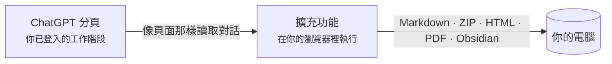

  

<h1 align="center">Chat &amp; Intelligent UI Exporter for ChatGPT</h1>

  把 ChatGPT 對話連同其中可互動的 <b>Intelligent UI</b> 卡片， 
  儲存為 Markdown、HTML、PDF，或直接存進 Obsidian。全程在你的電腦上完成。

  
  
  
  
  

  <a href="../../README.md">English</a> ·
  <a href="README.zh-CN.md">简体中文</a> ·
  <b>繁體中文</b> ·
  <a href="README.ja.md">日本語</a> ·
  <a href="README.ko.md">한국어</a> ·
  <a href="README.es.md">Español</a> ·
  <a href="README.pt-BR.md">Português</a> ·
  <a href="README.fr.md">Français</a> ·
  <a href="README.de.md">Deutsch</a> ·
  <a href="README.ru.md">Русский</a>

  <a href="#安裝">安裝</a> ·
  <a href="#能匯出什麼">能匯出什麼</a> ·
  <a href="#快速上手">快速上手</a> ·
  <a href="#常見問題">常見問題</a> ·
  <a href="../../PRIVACY.md">隱私</a> ·
  <a href="#意見回饋">意見回饋</a>

  

> 截圖是英文介面；擴充功能會跟隨瀏覽器語言，中文瀏覽器裡顯示的就是中文。

## 為什麼做這個

ChatGPT 的回答早就不只是文字了：表格、公式、生成的圖片、程式碼解譯器產出的檔案，還有越來越多帶分頁、滑桿和按鈕的**互動卡片**（Intelligent UI）。複製貼上會丟掉大半，ChatGPT 內建的資料匯出給你的只是原始 JSON。

這個擴充功能像 ChatGPT 頁面那樣讀取對話，再完整地寫出來：

- **一點不漏。** 內文保持可編輯，原圖和檔案都下載下來；每張卡片既存成圖片，又保留文字，照樣能搜尋。
- **卡片還能用。** 在 HTML 匯出裡，卡片會重新執行：切換分頁、拖動滑桿，數字跟著變。
- **從設計上就保護隱私。** 沒有伺服器、不用註冊、沒有統計、不呼叫 AI。詳見 [PRIVACY.md](../../PRIVACY.md)。

## 能匯出什麼

| 格式 | 檔案 | 適合 |
| --- | --- | --- |
| **Markdown 純文字** | `.md` | 筆記軟體、快速複製。帶表格、程式碼、公式和來源連結的 Markdown。 |
| **Markdown 壓縮檔** | `.zip` | 什麼都留著：Markdown 加原圖、卡片圖、上傳的和生成的檔案。 |
| **HTML 網頁** | `.html`（或 `.html.zip`） | 閱讀和分享。外觀接近 ChatGPT，卡片可以操作。 |
| **PDF（列印）** | 透過列印對話框 | 列印、繳交。文字能選取、能搜尋，A4 排版。 |
| **Obsidian** | 你筆記庫裡的一篇筆記 | 存進你選的資料夾，並開啟這篇筆記。 |

可以匯出整段對話，也可以只匯出勾選的訊息；已儲存的對話（`/c/…`）和分享連結（`/share/…`）都行。長對話通常一秒左右就匯出完，分頁在背景也可以。

### Intelligent UI 卡片，兩種方式保存

<table>
  <tr>
    <td width="50%" valign="top">
      <b>HTML 網頁：卡片照樣能用</b>  
      
    </td>
    <td width="50%" valign="top">
      <b>Markdown：一張圖加可搜尋的文字</b>  
      
<pre lang="markdown">

&gt; [!note]- 卡片文字
&gt; **Kyoto trip budget** · [Estimate]
&gt; 選項：Budget / **Comfort** / Luxury
&gt; | Item  | Per day | Total |
&gt; | Hotel | \$160   | \$480 |
&gt; …</pre>
    </td>
  </tr>
</table>

卡片只在其他狀態下才顯示的文字（其他分頁、展開後的折疊區），列在「卡片在其他狀態下的內容」裡，不會藏在一次點擊後面。各格式的細節見 [docs/export-formats.md](../export-formats.md)（英文）。

## 安裝

> [!NOTE]
> Chrome 線上應用程式商店版本即將上架。在那之前，請從這個儲存庫載入。

1. 下載本儲存庫（[**Code → Download ZIP**](https://github.com/letheli710/chat-intelligent-ui-exporter/archive/refs/heads/main.zip)）並解壓縮，或用 `git clone`。
2. 開啟 `chrome://extensions`，開啟右上角的**開發人員模式**。
3. 按**載入未封裝項目**，選擇 `extension` 資料夾。
4. 在 [chatgpt.com](https://chatgpt.com) 開啟一段對話，輸入框旁會出現兩個按鈕。

為 Chrome 打造。其他支援 Manifest V3 的 Chromium 瀏覽器（Edge、Brave）應該也能用，但沒有測試過。

## 快速上手

1. **開啟一段 ChatGPT 對話。**
2. **按輸入框旁的匯出按鈕**，或工具列上的擴充功能圖示。
3. 在旁邊的選單裡**選格式**，選過會記住。
4. 只想匯出一部分？開啟**側邊欄**（清單按鈕，或 <kbd>Alt</kbd>+<kbd>Shift</kbd>+<kbd>E</kbd>），勾選訊息，再按**匯出**。

檔案存到「下載」資料夾（也可以每次自己選位置，見「設定」）。存進 Obsidian 時，第一次選好筆記資料夾，之後**儲存**寫入筆記，**開啟**直接跳過去。

 

  

## 運作方式

- 擴充功能用瀏覽器已有的登入狀態，向 ChatGPT 自己的網站讀取對話。不捲動頁面，也不擷取頁面畫面。
- 卡片是在擴充功能內部一個隔離的沙箱頁面裡執行卡片程式畫出來的，所以和 ChatGPT 上看到的一樣。
- 不會傳到我們的伺服器，因為根本沒有伺服器。

## 設定

從側邊欄的齒輪、工具列面板或擴充功能的設定頁開啟。每項旁邊的 ⓘ 有說明，有幾項還會開啟帶範例的說明頁。

<b>看看設定頁</b>

 

| 設定 | 管什麼 |
| --- | --- |
| **匯出用途**：通用 / Obsidian | 通用會把 ChatGPT 寫在回答裡的 HTML 顯示成文字，換什麼軟體看都一樣；Obsidian 會保留它的效果（折疊區塊、小圖）。 |
| **HTML 網頁的形式** | 單一檔案（預設，方便傳送）或帶資料夾的 ZIP（網頁更小，圖片多時更合適）。[詳情](../export-formats.md#html-page) |
| **檔名格式** | 標題、標題加日期、日期加標題，或自訂前綴。 |
| **Markdown 內容** | Obsidian 屬性（標題、來源、時間、模型）、訊息時間戳記、角色名稱。 |
| **圖文卡片用 HTML**（Beta） | 把圖文清單卡片寫成左圖右文的 HTML，而不是表格。 |
| **每次匯出時選擇儲存位置** | 每次匯出都問存到哪裡，而不是直接放進「下載」。 |
| **語言** | 跟隨瀏覽器，或在 10 種語言裡選一種。 |

## 隱私和權限

擴充功能從不把你的對話傳到任何地方。完整政策見 [PRIVACY.md](../../PRIVACY.md)，簡單說：

| 權限 | 為什麼需要 |
| --- | --- |
| `chatgpt.com`、`chat.openai.com` | 顯示按鈕，讀取你正在看的對話。 |
| `images.openai.com` | 下載搜尋結果裡的圖片，不帶 cookie。 |
| `scripting` | 安裝或更新擴充功能時，把面板加到已經開啟的 ChatGPT 分頁裡。 |
| `downloads` | 儲存匯出的檔案。 |
| `storage` | 記住你的設定，只存在你的電腦上。 |

> [!TIP]
> 匯出的 HTML 頁面和一般網頁一樣：如果對話本身引用了網路上的圖片或應用，開啟檔案時瀏覽器會去載入它們。地圖預設不連網，除非你按「連網查看可拖曳的地圖」。

## 常見問題

<b>快速鍵沒反應，或者開啟的是工具列面板而不是側邊欄。</b>

Chrome 只在第一次安裝擴充功能時指派建議的 <kbd>Alt</kbd>+<kbd>Shift</kbd>+<kbd>E</kbd>，如果這組按鍵已被其他擴充功能占用也不會指派。開啟 `chrome://extensions/shortcuts`，在「開啟 / 關閉匯出側邊欄」這一列設定按鍵；另一列是 Chrome 內建的，開啟的是工具列面板。擴充功能設定裡會顯示目前實際綁定的按鍵。

<b>選單一檔案還是 ZIP？</b>

兩種開啟後效果和互動完全一樣。單一檔案最方便傳送，但比裡面的圖片大約多三分之一；圖片很多時，ZIP 開啟更快，原圖也能單獨取出來用。對話裡圖片和附件超過 10 個時，擴充功能會建議你改用 ZIP，按一下就行。

<b>HTML 頁面裡有些地方變成了「Removed」框。</b>

保留 ChatGPT 寫在回答裡的 HTML 時，凡是可能執行程式碼的部分（嵌入頁面、播放器、表單、指令碼連結）都會在寫進檔案前去掉。框裡寫著去掉了什麼，並連結到 [docs/html-filter.md](../html-filter.md)（英文），逐項說明原因。

<b>會匯出我重新產生的其他回答嗎？</b>

暫時不會：只匯出頁面上目前顯示的那一個回答。卡片按預設狀態匯出，因為 ChatGPT 不儲存你點過的狀態；其他狀態會以文字列出。

<b>在 Markdown 軟體裡看不到圖片。</b>

讓 `conversation.md` 和它的 `assets/` 資料夾放在一起，圖片用的是相對路徑。要圖片請用 **Markdown 壓縮檔（.zip）**；**Markdown 純文字**只寫 Markdown。

<b>分享連結和免費版能用嗎？</b>

能。已儲存的對話和分享連結都可以，什麼方案都行。匯出自己的對話需要登入；分享連結只要 ChatGPT 能顯示，不登入也能匯出。

<b>會把東西傳給 OpenAI 或你嗎？</b>

擴充功能只會向 ChatGPT 的網站讀取你要匯出的那段對話，和頁面本身做的一樣。不會傳給開發者。「問題回報」連結開啟的是一個 Google 表單，你不送出就什麼都不會傳送。

## 文件

- [各匯出格式詳解](../export-formats.md)（英文）：每種格式裡有什麼、ZIP 的結構、卡片 / 地圖 / 嵌入應用 / PDF 頁面怎麼處理。
- [HTML 匯出會去掉什麼，為什麼](../html-filter.md)（英文）
- [隱私權政策](../../PRIVACY.md)（英文與簡體中文）
- [開發指南](../DEVELOPMENT.md)（英文）：建置、測試和檢查，上面的截圖是怎麼產生的。
- [第三方聲明](../../extension/THIRD_PARTY_NOTICES.md)

## 意見回饋

- 遇到問題或有建議？按工具列面板底部的**問題回報**，會開啟一個[簡短的表單](https://docs.google.com/forms/d/e/1FAIpQLSemj8AaDckqB2NJ_tsb3VW2jG1AxM-NIrmKJMom8IXtjUYgaQ/viewform)，並自動填好你的版本和瀏覽器。
- 習慣用 GitHub？[提一個 issue](https://github.com/letheli710/chat-intelligent-ui-exporter/issues)。請不要附上真實對話、HAR 檔案或 cookie。
- 歡迎提 Pull Request，先看看[開發指南](../DEVELOPMENT.md)。

## 致謝

使用了 [marked](https://github.com/markedjs/marked)（Markdown 轉 HTML）、[JSZip](https://stuk.github.io/jszip/)（打包）和 [Lucide](https://lucide.dev)（卡片圖示）。程式碼區塊圍欄長度和 KaTeX 標註擷取參考了 [otaliptus/chatgpt-markdown-exporter](https://github.com/otaliptus/chatgpt-markdown-exporter) 的做法。授權見 [extension/licenses](../../extension/licenses)。

## 授權

[MIT](../../LICENSE)。本專案與 OpenAI 無關，未獲其認可或贊助。ChatGPT 是 OpenAI 的商標。
